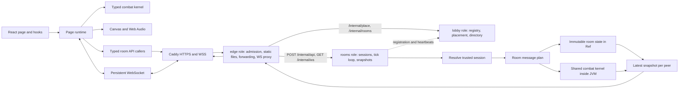

[简体中文](ARCHITECTURE.md) | [English](ARCHITECTURE.en.md) | **日本語**

# アーキテクチャとレビューガイド

## フロントエンド

`GamePage/index.tsx` はページの主要な領域を公開します。`useGame` は 1 つの `GameRuntime` のライフタイムを所有し、React を不変のビュースナップショットに購読させます。メニューや選択画面が表示されている間もバトル領域は canvas をマウントしたままにするため、画面の切り替えでレンダラー、入力リスナー、アニメーションループが再生成されることはありません。

フロントエンドの責務は次の境界に従います。

- `game/`：共有の戦闘ルール、ロスター、ムーブ、ドメイン型、入力処理、シミュレーションプロトコル。ブラウザーと Scala の GraalJS アダプターの両方が利用します。
- `assets/`：アプリケーションレベルのマニフェスト読み込み、メディア型、バンドアートワークの検索。アプリケーション起動とページ表示は同じモジュールを使います。ソース素材はリポジトリ直下の `assets/` に、実行時素材は `frontend/public/` に残ります。
- `apis/`：共通の HTTP 基盤と、登録済みのルームメッセージごとに 1 つの呼び出し元、さらに永続的な `rooms/RoomConnection` トランスポート。
- `pages/GamePage/runtime/`：命令型のブラウザー系システム。`GameRuntime` はライフサイクルとフレーム順序を可視化し、`audio/`、`input/`、`network/`、`display/`、`rendering/` がそれぞれリソースとクリーンアップを所有します。
- `pages/GamePage/components/`：可視領域。BattlePanel、CharacterSelection、LanLobby は簡潔なエントリーを持ち、ビジネス領域とローカル hook を近くに配置します。ロスター、立ち絵、出場ラインナップ、バトルルールのコントロールは、ローカルとオンラインの両方の選択で使うためページ共有のままです。単純なコンポーネントはフラットに保ちます。
- `pages/GamePage/functions/` と `objects/`：ページ共有の純粋な投影と表示型。`buildBattleView` は可変のファイターオブジェクトを React に漏らさずに権威ある戦闘値を投影します。
- `components/ui/`：アプリケーションに依存しない UI プリミティブ。

CharacterSelection の hook はローカルの選択コントローラー、プレビュー、設定、確認を調整します。LanLobby の hook はルームコマンド、トークン、ドラフト候補、保留中のコマンド状態を所有し、表示コンポーネントはデータとコールバックを受け取ります。HTTP レスポンスが成功しても、対応する権威あるルームフィールドが届くまでコマンドは解放されません。無関係な更新が先に届いた場合も同様です。BattlePanel の表示 hook は全画面リスナーとクリーンアップを所有し、そのエントリーはステージ、HUD、コントロール、オーバーレイを直接表示します。タッチ操作は大きな統合 J/K ボタンを使います。短いタップは J を送り、300 ms の長押しは J を送らずに K を送ります。直線のプログレスバーと強攻撃のアートワークが長押し状態を示します。U/I/O は周囲の 3 つのスロットを占め、P は右側の中ボタン、L は下部のジョイスティックの隣にあります。保留中のジェスチャーはバトル、キャラクター、フォームの変化でキャンセルされます。それらの静的アートワークは既存のアクションフレームとフィニッシュアートを使って現在のキャラクター／フォームに追従します。参照カウント付きの画像キャッシュは未使用のシートを解放し、アイコン canvas はアートワークまたは表示サイズが変わったときだけ再描画されます。ポインターキャプチャーにより、ジョイスティックと攻撃入力を同時に保ちます。ジョイスティックは可視ラベルや全画面ガイダンスなしで、アクセシブルな移動説明を保持します。ナビゲーションは矢印の装飾がない共有のボーダーレス Button を使います。

`GameRuntime` は入力、戦闘、ネットワーク、エフェクトのアダプターを調整し、`GameView` は表示スナップショットを運びます。そのネットワークヘルパーは有界の予測、最新状態の再生、信頼できるイベントの消費、診断を所有します。`CanvasRenderer` は戦闘状態を受け取りますが変更しません。`AudioDirector` は独立したチャンネルを所有し、破棄時にオーディオリソースを解放します。DOM リスナー、ソケット、アニメーションフレーム、再接続タイマーはすべてクリーンアップを持ちます。

厳格な TypeScript がフロントエンド全体をカバーします。2 つ目の設定 `frontend/tsconfig.kernel.json` は DOM やブラウザーのアンビエント型なしで共有戦闘コードをすべてチェックします。`npm run check` に含まれる `scripts/check-frontend-structure.mjs` は import と re-export をチェックします。共有戦闘コードは自己完結を保ち、トランスポートとアセットはページ内部を import できず、ランタイムは React 領域を import できず、複雑な領域は互いの内部に踏み込めません。共有 UI プリミティブとアプリケーション起動は独自の依存境界を持ちます。

`game/engine.ts` はシリアライズ可能な対戦状態と公開戦闘 API を所有します。ルールの実装は `game/match/` にあり、所有する `Match` を明示的に受け取ります。カーネルには、フラグで不変条件を確立するムーブ機構のため、いくつかの non-null アサーションが残っています。

### 戦闘レビューマップ

| 責務                                                                       | `frontend/src/game/` 配下の実装                                 |
| -------------------------------------------------------------------------- | --------------------------------------------------------------- |
| 対戦状態、構築、固定ステップの累積、公開 API                               | `engine.ts`                                                     |
| 1 回の 10 ms ステップと同時接触の順序                                      | `match/tick.ts`                                                 |
| ラウンド設定、ノックアウト判定、リレーリソースの引き継ぎ                   | `match/rounds.ts`                                               |
| 地形、着地、プラットフォーム照会、ボディ分離                               | `match/terrain.ts`                                              |
| 入力履歴、コマンド選択、キャンセルウィンドウ                               | `match/commands.ts`                                             |
| ファイターのタイマー、ガード、入力バッファリング                           | `match/fighter.ts`                                              |
| ムーブの正当性、リソース消費、攻撃発生時の効果                             | `match/bufferedAttack.ts`                                       |
| ジャンプ、ダッシュ、移動、位置積分                                         | `match/movement.ts`                                             |
| ヒット、ガード、カウンター、ダメージ、共鳴の解決                           | `match/hits.ts`                                                 |
| 飛び道具、召喚、持続する領域／制御効果                                     | `match/projectiles.ts`, `match/summons.ts`, `match/areas.ts`    |
| 変身の終了と CPU ナビゲーション（バンド戦術は `band.ai`）                  | `match/forms.ts`, `match/cpu.ts`                                |
| ワールド定数、フラットなロスター、共有プロファイルスケーリング             | `data/rules.ts`, `data/roster.ts`                               |
| カタログの組み立て、共有スケール／バランスパス、ムーブリストのルーティング | `data/createMoveCatalog.ts`, `data/moves/`, `data/listMoves.ts` |
| バンドの契約、レジストリ、ロスター、ムーブ、フォーム、アビリティ           | `bands/`（`docs/BANDS.md` を参照）                              |

`combatData.ts` は引き続き共有カタログのエントリーです。`bands/` 配下の各登録バンドは、自らのロスター、ローカルのムーブ組み立て、フォーム、ムーブリスト、コマンドテーブル、キャンセルルール、CPU 戦術、バランス調整後のチューニングを所有します。Mujica と MewType はもはや実装をレガシーフォルダーに分散させていません。共有ディスパッチは `bandFor(id)` を使います。手書きのムーブは各バンドの `characters/<key>/<form>.ts` にあり、バンドの `shared/` は再利用可能な構築テンプレートを保持し、`moves.ts` は登録順を保ちます。Penguin は高松燈（Tomori）のフォームで、Viola（薇欧拉）は他の MewType キャラクターと同じ仮想フォームのレイアウトに従います。
`data/createMoveCatalog.ts` はパスの順序を可視化します。バンドのムーブ記録をマージし、MyGO のジャブを登録し、共有の移動スケーリングを適用し、チェーンを登録し、共有バランスを適用し、各バンドの `tune` を実行してからカタログを検証します。これらのパスはカタログごとに 1 回実行されます。バンドモジュールは遅延バインディングの `bands/shared/catalog.ts` を通じてチューニング済みの値を読み、レジストリの循環を避けます。Poppin'Party のオフラインドラフトは未登録のままです。契約とバンド追加のレシピは `docs/BANDS.md` にあります。

`objects/` は共有の戦闘構造を保持します。ルールヘルパーは `Match` にインスタンス状態を追加しません。スナップショットのフィールド、シード付き乱数源、公開メソッドのシグネチャは、ローカル対戦、権威シミュレーション、予測と互換のままです。

### レンダリングレビューマップ

レンダリングコードは `pages/GamePage/runtime/rendering/` に属します。`CanvasRenderer.ts` は画像を読み込み、スプライトを選択し、視覚補正を適用します。`createBattleScene.ts` は視覚状態のライフタイムを所有し、現在の対戦を描画ヘルパーに提供します。

`battleScene/frame.ts` はレイヤー順を示します。近くのモジュールはスプライト、イベントからエフェクトへの変換、パーティクルのライフタイム、変身オーラ、長崎そよ（Soyo）のエフェクト、攻撃、防御、ボーカル、Mujica のスキルを扱います。`battleScene/objects.ts` は関連する視覚状態とコンテキストを定義します。これらはレンダラー内のローカルな値であり、描画は戦闘状態を変更しません。

`createProjectileRenderer.ts` は基本、ボーカル、Mujica、MewType のシルエットごとに `projectiles/` へディスパッチします。`createStageRenderer.ts` は情景と地形の描画を所有します。キャラクター固有の `draw*Skills.ts` はこれらのレンダラーの隣に残ります。カメラと手書きのポーズ／モーション選択はレンダラーの隣の `Camera.ts` と `animation/` にあります。入場のタイミングは `game/data/rules.ts` を通じて共有され、視覚的な入場プロファイルはレンダラー内に残ります。ページの調整、オーディオ、入力、ネットワークは `runtime/` にあり、マニフェストの読み込みはアプリケーションのアセットモジュールに属します。

## バックエンド

1 つのリリース成果物に 3 つのデプロイ可能なロールと共有システム基盤が含まれます。本番環境では `SERVICE_ROLE=edge|lobby|rooms` を独立した systemd ユニットとして実行します。既定の `all` モードは同じロールを 1 つの JVM に組み合わせ、ループバックの背後でローカルデバッグ用に動かします。[バックエンドサービス](SERVICES.ja.md) はトポロジー、内部契約、設定、障害時の挙動の参照先です。

- `edge`：唯一の公開リスナーです。静的ファイルと `/api/health` を提供し、ルーム作成、参加、ソケットハンドシェイクにクライアント単位の受入制限を適用し、`POST /api/{name}` を所有する rooms インスタンスへ転送し、`GET /ws?room=CODE` の WebSocket フレームをブリッジします。短命のルームコード → インスタンスキャッシュを保持し、ルーム状態は所有しません。
- `lobby`：内部 `127.0.0.1:8079` です。rooms のハートビートからインスタンスレジストリとルームコードディレクトリを再構築し、グローバルなルーム予算と配置予約を所有し、edge に配置と所有者の照会を返します。永続状態を持たず、戦闘経路にも入りません。
- `rooms`：インスタンスごとに 1 つの内部プロセスです。セッション、ルームメンバーシップ、選択、準備完了、読み込みバリア、対戦ライフサイクル、入力検証、120 Hz のルームループ、スナップショットを所有します。独自の `MAX_ROOMS` を適用し、ルームごとに制限された GraalJS コンテキストで共有戦闘カーネルを実行し、lobby に登録とハートビートを報告します。
- `system`：`Main` のロールディスパッチ、静的配信、共有の `OriginCheck`/`InternalGuard`、プロセス間ペイロード型です。ルームメッセージフレームワーク（`APIMessage`、`APIMessageRouter`、`APIRegistration`）は、ルームメッセージを実行するのがこのロールだけであるため `services/rooms` に属します。

プロセス間ペイロード型は `services/system/objects/internal/` にあります。内部エンドポイントはループバックからのピアを要求し、`INTERNAL_SECRET` が設定されている場合は `X-Mygo-Internal` ヘッダーも要求します。ルーム API 呼び出しは edge から 1 回のループバックホップを越えます。ルームの tick 経路はプロセス間呼び出しを一切行わないため、tick ループ、そのセマフォ、カーネルはプロセス内に留まります。

HTTP 操作は `final case class ...Message` の値で、入力はコンストラクター引数に置き、`plan(connection): IO[Response]` を提供します。すべてのフロントエンド操作には `frontend/src/apis/rooms/` 配下に対応する呼び出し元があります。登録名は `Message` を除いて型名を小文字化して導出します。Vite はミニファイ時に API クラス名を保持します。

`RoomRoutes.apiMessages` は公開 HTTP 操作を 1 回だけ登録します。`AttachRoomMessage`、`SubmitInputMessage`、`DisconnectRoomMessage` などの内部操作はソケット境界が使い、不要な HTTP エンドポイントやフロントエンド呼び出し元ファイルを持ちません。rooms プロセスはそれらを `/internal/api` と `/internal/ws` の下で内部的に公開し、edge はルームロジックを複製せずに同じ公開プロトコルを転送します。最上位のプロセスは個々の API を列挙するのではなく、ロールのルーティングを組み合わせます。

rooms ルーターは、信頼できる `Session` を含むメッセージを構築する前に bearer トークンを解決します。クライアントが自分のプレイヤー側を選ぶことはありません。ホスト専用の操作はその信頼できる側を検査します。ソケットが置き換わると、以前のピアは入力を送信できなくなります。

`RoomState` は不変です。所有する `Ref` が連続する状態を保持します。ルームごとに 1 つの `Semaphore` がコマンドとシミュレーション呼び出しを直列化するため、2 つの参加が同じスロットを奪うことはなく、2 つの JVM ファイバーが同じ GraalJS コンテキストへ同時に入ることもありません。別々のルームは並行して進めます。ビジーなルームは自分のクロック反復をスキップするため、新しい対戦の準備が既存のルームを止めることはありません。rooms ランタイムのヘルパーは `private[rooms]` の可視性を使います。

アプリケーション接続とルームランタイムは実際のエフェクトリソースを保持します。それらはシリアライズ可能なドメインデータとは意図的に分離されています。一時的な対戦に SQL、永続化層、転送専用のサービス層は不要です。lobby のレジストリと edge の所有者キャッシュは有界のインメモリ構造で、再起動後に再構築されます。rooms プロセスは引き続きライブなルーム状態の唯一の所有者です。

## 共有シミュレーション

`scripts/build-simulation.mjs` は TypeScript カーネルを JVM リソースにバンドルします。Scala の `Simulation` アダプターは、ホストアクセスもクラス検索も許可しないプライベートな GraalJS コンテキストを作成します。検証済みの入力と設定だけを受け取ります。バックエンドはクライアントが提供したコードを実行しません。

サーバーは、両方のクライアントが現在の世代を確認した後にのみ対戦を開始します。入力は増加するシーケンス番号とアクションごとの押下カウンターを運びます。短いタップは、リリースが先に届いても、シミュレーションの tick が消費するまでラッチされます。古いシーケンスは無視されます。再起動、一時停止、ラウンド遷移は保留中の入力を解放します。

ブラウザーはサーバーパケットの間を予測してローカルの移動を即座に表示します。各権威パケットは、視覚アニメーションのためにファイターオブジェクトの同一性を保ちながら予測モデルを置き換えます。予測イベントは破棄され、サーバーイベントだけがオンラインの音声と映像をトリガーします。新しい権威パケットがない場合、予測は平滑化した往復時間に基づき、100–250 ms の地平の後に停止します。ダメージ、リソース、勝敗、ラウンド遷移はサーバーが決定します。

## アセットとクリーンアップ

フロントエンドのシェルは小さな Vite ビルドです。`assets.json` はコンテンツアドレス指定のメディアファイルを参照します。選択されたバトル画像はプレイ前にデコードされウォームアップされます。変更されていないメディアには不変のキャッシュヘッダーが付きます。元のシートとクレジットは `assets/` の下に残り、任意のアートワークワークフローに供給されます。MyGO のシートは `assets/characters/mygo/<character>/` にまとめられ、[アセットカタログ](../assets/README.ja.md) が所有権とパス規約を説明します。

以前の埋め込み HTML ファイル、グローバルスクリプトランタイム、Node の LAN サーバー、不要になったブラウザースクリプト、生成されたスクリーンショット履歴は削除されました。Git 履歴は以前の実装を保持しています。`.idea/` と生成されたビルド成果物は無視されます。
