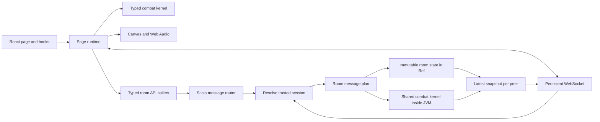

# Architecture and review guide

## Frontend

`GamePage/index.tsx` exposes the page's visible regions. `useGame` owns a `GameRuntime` lifetime and subscribes React to immutable view snapshots. `GameRuntime` coordinates input, the combat clock, networking and effect adapters. `GameView` contains the data needed for display; components do not mutate the battle model.

`CharacterSelection` keeps the selection controller and snapshots local to its page region. Its actions validate team size and uniqueness. `CanvasRenderer` receives a match and never changes its combat state. `AudioDirector` owns independent channels and releases audio resources when disposed. DOM listeners, sockets, animation frames and reconnect timers all have cleanup.

`useMobilePlay` selects the coarse-pointer battle layout; `functions/immersive.ts` wraps best-effort fullscreen and orientation locking; `BattlePanel` renders the full-field stage with its floating pause/exit controls, the windowed toolbar and the page-local `TouchControls` pads. These adapters only affect page layout and input, so the combat kernel and renderer stay view-agnostic.

`game/engine.ts` owns serializable match state and the public combat API. Its rule implementations live in `game/match/` and receive the owning `Match` explicitly. Strict TypeScript, including unused-local and unused-parameter checks, covers the frontend and shared kernel. The kernel retains some non-null assertions for move mechanics whose corresponding flags establish the invariant.

### Combat review map

| Responsibility                                                    | Implementation under `frontend/src/game/`                        |
| ----------------------------------------------------------------- | ---------------------------------------------------------------- |
| Match state, construction, fixed-step accumulation and public API | `engine.ts`                                                      |
| One 10 ms step and simultaneous-contact order                     | `match/tick.ts`                                                  |
| Round setup, knockout decisions and relay resource carry-over     | `match/rounds.ts`                                                |
| Terrain, landing, platform queries and body separation            | `match/terrain.ts`                                               |
| Input history, command selection and cancel windows               | `match/commands.ts`                                              |
| Fighter timers, guard and input buffering                         | `match/fighter.ts`                                               |
| Move legality, resource spending and attack startup effects       | `match/bufferedAttack.ts`                                        |
| Jump, dash, locomotion and position integration                   | `match/movement.ts`                                              |
| Hit, guard, counter, damage and resonance resolution              | `match/hits.ts`                                                  |
| Projectiles, summons and persistent area/control effects          | `match/projectiles.ts`, `match/summons.ts`, `match/areas.ts`     |
| Transformation exit and CPU navigation (band tactics in `band.ai`) | `match/forms.ts`, `match/cpu.ts`                                 |
| World constants, flat roster and shared profile scaling           | `data/rules.ts`, `data/roster.ts`                                |
| Catalog assembly, shared scale/balance passes and move-list routing | `data/createMoveCatalog.ts`, `data/moves/`, `data/listMoves.ts`  |
| Band contract, registry, rosters, moves, forms and abilities      | `bands/` (see `docs/BANDS.md`)                                   |
| Authored pose selection and whole-body motion                     | `animation/createAnimator.ts`, `animation/createMujicaMotion.ts` |

`combatData.ts`, `mujica.ts`, `mewtype.ts` and `animation.ts` retain their existing import paths. Band modules in `bands/` own their roster, moves, forms, move list, command table, cancel rules, CPU tactics and post-balance tuning; the shared engine only dispatches through `bandFor(id)` and never branches on character ids. `data/createMoveCatalog.ts` keeps the pass order visible: merge band move records, register MyGO jabs, apply shared movement scaling, register chains, apply shared balance, run each band's `tune`, then validate the catalog. These passes run once per catalog; band modules read tuned values through the late-bound `bands/shared/catalog.ts`, which avoids a registry cycle. The registry contract and the add-a-band recipe live in `docs/BANDS.md`.

`objects/` contains the shared battle structures. Rule helpers add no instance state to `Match`; the snapshot fields, seeded random source and public method signatures remain compatible with local play, authoritative simulation and prediction.

### Rendering review map

Rendering code belongs to `pages/GamePage/functions/rendering/`. `CanvasRenderer.ts` loads images, chooses sprites and applies visual correction. `createBattleScene.ts` owns the lifetime of visual state and supplies the current match to its drawing helpers.

`battleScene/frame.ts` shows the layer order. Nearby modules handle sprites, event-to-effect translation, particle lifetimes, transformation auras, Soyo effects, offense, defense, vocals and Mujica skills. `battleScene/objects.ts` defines the related visual state and context. These are renderer-local values; drawing does not mutate combat state.

`createProjectileRenderer.ts` dispatches into `projectiles/` for base, vocal, Mujica and MewType silhouettes. `createStageRenderer.ts` owns scenery and terrain painting. Character-specific `draw*Skills.ts` files remain next to these renderers. Page coordination, audio, input and asset loading remain in the parent `functions/` folder.

## Backend

There are two logical services in one JVM:

- `rooms`: session ownership, room membership, selection, readiness, loading barriers, match lifecycle, input validation and snapshots.
- `system`: shared message infrastructure, application resources, HTTP startup and static serving.

HTTP operations are `final case class ...Message` values with constructor inputs and `plan(connection): IO[Response]`. Every frontend operation has a matching caller under `frontend/src/apis/rooms/`. Registered names are derived by removing `Message` and lowercasing the type name. Vite preserves API class names during minification.

`RoomRoutes.apiMessages` registers public HTTP operations once. Internal operations such as `AttachRoomMessage`, `SubmitInputMessage` and `DisconnectRoomMessage` are used by the socket boundary and have no unnecessary HTTP endpoints or frontend caller files. The top-level server combines service routing rather than listing individual APIs.

The router resolves bearer tokens before constructing messages containing a trusted `Session`. The client never chooses its player side. Host-only operations inspect that trusted side. A replacement socket invalidates the previous peer's ability to submit inputs.

`RoomState` is immutable. Its owning `Ref` stores successive states. One `Semaphore` per room serializes commands and simulation calls, so two joins cannot claim the same slot and two JVM fibers cannot enter the same GraalJS context concurrently. Separate rooms can advance concurrently. A busy room skips its own clock iteration, so preparing a new match does not stall existing rooms. Helpers in the rooms runtime use `private[rooms]` visibility.

The application connection and room runtime hold actual effect resources. They are intentionally separate from serializable domain data. No SQL, persistence layer or forwarding-only service layer is needed for ephemeral matches.

## Shared simulation

`scripts/build-simulation.mjs` bundles the TypeScript kernel into a JVM resource. The Scala `Simulation` adapter creates a private GraalJS context without host access or class lookup. It receives only validated inputs and configuration. The backend does not execute client-supplied code.

The server starts a match only after both clients acknowledge the current generation. Inputs carry increasing sequence numbers and per-action press counters. A short tap is latched until a simulation tick consumes it, even if its release arrives first. Stale sequences are ignored. Restart, pause and round transitions release pending inputs.

The browser predicts between server packets to show local movement immediately. Each authoritative packet replaces the predicted model while preserving fighter object identity for visual animation. Predicted events are discarded; only server events trigger online sound and video. Prediction stops after a 100–250 ms horizon without fresh authoritative packets, based on smoothed round-trip time. The server decides damage, resources, outcomes and round transitions.

## Assets and cleanup

The frontend shell is a small Vite build. `assets.json` references content-addressed media files. Selected battle images are decoded and warmed before play; unchanged media receive immutable cache headers. Original sheets and attribution remain under `assets/` and feed the optional artwork workflow. MyGO sheets are grouped under `assets/mygo/<character>/`; the [asset catalog](../assets/README.md) describes ownership and path conventions.

The former embedded HTML files, global-script runtime, Node LAN server, obsolete browser scripts and generated screenshot history were removed. Git history retains the previous implementation. `.idea/` and generated build artifacts are ignored.
