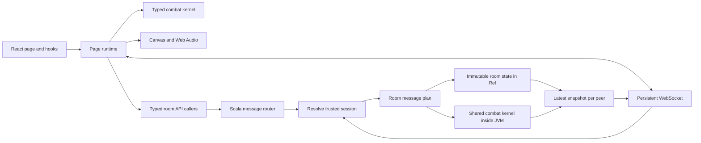

# Architecture and review guide

## Frontend

`GamePage/index.tsx` exposes the page's visible regions. `useGame` owns a `GameRuntime` lifetime and subscribes React to immutable view snapshots. `GameRuntime` coordinates input, the combat clock, networking and effect adapters. `GameView` contains the data needed for display; components do not mutate the battle model.

`CharacterSelection` keeps the selection controller and snapshots local to its page region. Its actions validate team size and uniqueness. `CanvasRenderer` receives a match and never changes its combat state. `AudioDirector` owns independent channels and releases audio resources when disposed. DOM listeners, sockets, animation frames and reconnect timers all have cleanup.

`game/engine.ts` is the complete fixed-step state machine. `combatData.ts`, `mujica.ts` and `mewtype.ts` define roster and move data. `objects/` names the battle structures. Strict TypeScript, including unused-local and unused-parameter checks, covers the frontend and shared kernel. The kernel retains some non-null assertions for move mechanics whose corresponding flags establish the invariant.

## Backend

There are two logical services in one JVM:

- `rooms`: session ownership, room membership, selection, readiness, loading barriers, match lifecycle, input validation and snapshots.
- `system`: shared message infrastructure, application resources, HTTP startup and static serving.

HTTP operations are `final case class ...Message` values with constructor inputs and `plan(connection): IO[Response]`. Every frontend operation has a matching caller under `frontend/src/apis/rooms/`. Registered names are derived by removing `Message` and lowercasing the type name. Vite preserves API class names during minification.

`RoomRoutes.apiMessages` registers public HTTP operations once. Internal operations such as `AttachRoomMessage`, `SubmitInputMessage` and `DisconnectRoomMessage` are used by the socket boundary and have no unnecessary HTTP endpoints or frontend caller files. The top-level server combines service routing rather than listing individual APIs.

The router resolves bearer tokens before constructing messages containing a trusted `Session`. The client never chooses its player side. Host-only operations inspect that trusted side. A replacement socket invalidates the previous peer's ability to submit inputs.

`RoomState` is immutable. Its owning `Ref` stores successive states. One `Semaphore` per room serializes commands and simulation calls, so two joins cannot claim the same slot and two JVM fibers cannot enter the same GraalJS context concurrently. Separate rooms can advance concurrently. A busy room skips its own clock iteration, so preparing a new match does not stall existing rooms. Helpers in the rooms runtime use `private[rooms]` visibility.

The application connection and room runtime hold actual effect resources. They are intentionally separate from serializable domain data. No SQL, persistence layer or forwarding-only service layer is needed for ephemeral matches.

## Shared simulation

`scripts/build-simulation.mjs` bundles the TypeScript kernel into a JVM resource. The Scala `Simulation` adapter creates a private GraalJS context without host access or class lookup. It receives only validated inputs and configuration. The backend does not execute client-supplied code.

The server starts a match only after both clients acknowledge the current generation. Inputs carry increasing sequence numbers and per-action press counters. A short tap is latched until a simulation tick consumes it, even if its release arrives first. Stale sequences are ignored. Restart, pause and round transitions release pending inputs.

The browser predicts between server packets to show local movement immediately. Each authoritative packet replaces the predicted model while preserving fighter object identity for visual animation. Predicted events are discarded; only server events trigger online sound and video. Prediction stops after 100 ms without fresh authoritative packets. The server decides damage, resources, outcomes and round transitions.

## Assets and cleanup

The frontend shell is a small Vite build. `assets.json` references content-addressed media files. Selected battle images are decoded and warmed before play; unchanged media receive immutable cache headers. Original sheets and attribution remain under `assets/` and feed the optional artwork workflow.

The former embedded HTML files, global-script runtime, Node LAN server, obsolete browser scripts and generated screenshot history were removed. Git history retains the previous implementation. `.idea/` and generated build artifacts are ignored.
