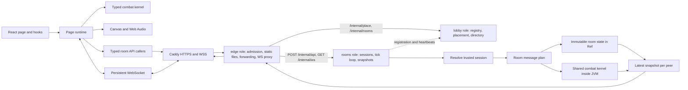

# Architecture and review guide

## Frontend

`GamePage/index.tsx` exposes the page's main regions. `useGame` owns one
`GameRuntime` lifetime and subscribes React to immutable view snapshots. The
battle region keeps its canvas mounted when menus or selection are visible,
so screen changes do not recreate the renderer, input listeners or animation loop.

Frontend ownership follows these boundaries:

- `game/`: shared combat rules, rosters, moves, domain types, input processing and
  simulation protocol. Both the browser and Scala's GraalJS adapter consume it.
- `assets/`: application-level manifest loading, media types and band artwork
  lookup. Application startup and page presentation use the same module; source
  media remains in the repository's top-level `assets/`, and runtime media remains
  in `frontend/public/`.
- `apis/`: common HTTP infrastructure and one caller per registered room message,
  plus the persistent `rooms/RoomConnection` transport.
- `pages/GamePage/runtime/`: imperative browser systems. `GameRuntime` keeps
  lifecycle and frame order visible; `audio/`, `input/`, `network/`, `display/` and
  `rendering/` own their resources and cleanup.
- `pages/GamePage/components/`: visible regions. BattlePanel, CharacterSelection
  and LanLobby have concise entries with nearby business areas and local hooks.
  Roster, portraits, lineups and battle-rule controls remain page-shared because
  local and online selection both use them. Simple components remain flat.
- `pages/GamePage/functions/` and `objects/`: page-shared pure projections and
  display types. `buildBattleView` projects authoritative combat values without
  leaking mutable fighter objects into React.
- `components/ui/`: application-independent UI primitives.

CharacterSelection's hook coordinates its local selection controller, preview,
settings and confirmation. LanLobby's hook owns room commands, tokens, draft
candidates and pending-command state; its presentation components receive data
and callbacks. A successful HTTP response does not unlock a command until the
corresponding authoritative room fields arrive, even if an unrelated update
arrives first. BattlePanel's display hook owns fullscreen listeners and cleanup;
its entry shows the stage, HUD, controls and overlays directly. Touch controls use a large combined J/K button: a short tap sends J, while a 300 ms hold sends K without also sending J. A straight progress bar and heavy-attack artwork show the hold state. U/I/O occupy three surrounding slots, P is the medium button on the right, and L sits beside the joystick at the bottom. Pending gestures cancel on battle, character or form changes. Their static artwork follows the current character/form using existing action frames and finish art; a reference-counted image cache releases unused sheets, and icon canvases redraw only when artwork or display size changes. Pointer capture preserves simultaneous joystick and attack input. The joystick retains accessible movement instructions without visible labels or fullscreen guidance. Navigation uses the shared borderless Button without arrow ornaments.

`GameRuntime` coordinates input, combat, networking and effect adapters, while
`GameView` carries display snapshots. Its networking helpers own bounded
prediction, latest-state replay, reliable event consumption and diagnostics.
`CanvasRenderer` receives combat state without mutating it. `AudioDirector` owns
independent channels and releases audio resources when disposed. DOM listeners,
sockets, animation frames and reconnect timers all have cleanup.

Strict TypeScript covers the complete frontend. A second configuration,
`frontend/tsconfig.kernel.json`, checks all shared combat code without DOM or
ambient browser types. `scripts/check-frontend-structure.mjs`, included in
`npm run check`, checks imports and re-exports: shared combat stays self-contained,
transport and assets cannot import page internals, runtime cannot import React
regions, and complex regions cannot reach into one another's internals. Shared
UI primitives and application startup have their own dependency boundaries.

`game/engine.ts` owns serializable match state and the public combat API. Rule
implementations live in `game/match/` and receive the owning `Match` explicitly.
The kernel retains some non-null assertions for move mechanics whose flags
establish the invariant.

### Combat review map

| Responsibility                                                      | Implementation under `frontend/src/game/`                       |
| ------------------------------------------------------------------- | --------------------------------------------------------------- |
| Match state, construction, fixed-step accumulation and public API   | `engine.ts`                                                     |
| One 10 ms step and simultaneous-contact order                       | `match/tick.ts`                                                 |
| Round setup, knockout decisions and relay resource carry-over       | `match/rounds.ts`                                               |
| Terrain, landing, platform queries and body separation              | `match/terrain.ts`                                              |
| Input history, command selection and cancel windows                 | `match/commands.ts`                                             |
| Fighter timers, guard and input buffering                           | `match/fighter.ts`                                              |
| Move legality, resource spending and attack startup effects         | `match/bufferedAttack.ts`                                       |
| Jump, dash, locomotion and position integration                     | `match/movement.ts`                                             |
| Hit, guard, counter, damage and resonance resolution                | `match/hits.ts`                                                 |
| Projectiles, summons and persistent area/control effects            | `match/projectiles.ts`, `match/summons.ts`, `match/areas.ts`    |
| Transformation exit and CPU navigation (band tactics in `band.ai`)  | `match/forms.ts`, `match/cpu.ts`                                |
| World constants, flat roster and shared profile scaling             | `data/rules.ts`, `data/roster.ts`                               |
| Catalog assembly, shared scale/balance passes and move-list routing | `data/createMoveCatalog.ts`, `data/moves/`, `data/listMoves.ts` |
| Band contract, registry, rosters, moves, forms and abilities        | `bands/` (see `docs/BANDS.md`)                                  |

`combatData.ts` remains the shared catalog entry. Each registered band under
`bands/` owns its roster, local move assembly, forms, move list, command table,
cancel rules, CPU tactics and post-balance tuning. Mujica and MewType no longer
split implementations across legacy folders. Shared dispatch uses `bandFor(id)`. Authored moves live in each band's `characters/<key>/<form>.ts`; the band's `shared/` holds reusable construction templates, and `moves.ts` preserves registration order. Penguin is Tomori's form, and Viola follows the same virtual-form layout as the other MewType characters.
`data/createMoveCatalog.ts` keeps the pass order visible: merge band move records,
register MyGO jabs, apply shared movement scaling, register chains, apply shared
balance, run each band's `tune`, then validate the catalog. These passes run once
per catalog. Band modules read tuned values through late-bound
`bands/shared/catalog.ts`, avoiding a registry cycle. Poppin'Party's offline draft
stays unregistered. The contract and add-a-band recipe live in `docs/BANDS.md`.

`objects/` contains the shared battle structures. Rule helpers add no instance state to `Match`; the snapshot fields, seeded random source and public method signatures remain compatible with local play, authoritative simulation and prediction.

### Rendering review map

Rendering code belongs to `pages/GamePage/runtime/rendering/`. `CanvasRenderer.ts` loads images, chooses sprites and applies visual correction. `createBattleScene.ts` owns the lifetime of visual state and supplies the current match to its drawing helpers.

`battleScene/frame.ts` shows the layer order. Nearby modules handle sprites, event-to-effect translation, particle lifetimes, transformation auras, Soyo effects, offense, defense, vocals and Mujica skills. `battleScene/objects.ts` defines the related visual state and context. These are renderer-local values; drawing does not mutate combat state.

`createProjectileRenderer.ts` dispatches into `projectiles/` for base, vocal, Mujica and MewType silhouettes. `createStageRenderer.ts` owns scenery and terrain painting. Character-specific `draw*Skills.ts` files remain next to these renderers. Camera and authored pose/motion selection live beside the renderer under `Camera.ts` and `animation/`. Entrance timing is shared through `game/data/rules.ts`; visual entrance profiles stay renderer-local. Page coordination, audio, input and networking live under `runtime/`; manifest loading belongs to the application asset module.

## Backend

One release artifact contains three deployable roles plus shared system infrastructure. Production runs `SERVICE_ROLE=edge|lobby|rooms` as separate systemd units; the default `all` mode composes the same roles in one JVM behind loopback for local debugging. [Backend services](SERVICES.md) is the reference for topology, the internal contract, configuration and failure behavior.

- `edge`: the only public listener. It serves static files and `/api/health`, applies per-client admission limits to room creation, joining and socket handshakes, forwards `POST /api/{name}` to the owning rooms instance and bridges `GET /ws?room=CODE` WebSocket frames. It keeps a short-lived room-code → instance cache and owns no room state.
- `lobby`: internal `127.0.0.1:8079`. It rebuilds an instance registry and room-code directory from rooms heartbeats, owns the global room budget and placement reservations, and answers placement and owner lookups for the edge. It holds no durable state and is not in the combat path.
- `rooms`: one internal process per instance. It owns sessions, room membership, selection, readiness, loading barriers, match lifecycle, input validation, the 120 Hz room loop and snapshots. It enforces its own `MAX_ROOMS`, runs the shared combat kernel in per-room restricted GraalJS contexts and reports registrations/heartbeats to the lobby.
- `system`: role dispatch in `Main`, static serving, the shared `OriginCheck`/`InternalGuard` and the cross-process payload types. The room message framework (`APIMessage`, `APIMessageRouter`, `APIRegistration`) belongs to `services/rooms` because only that role executes room messages.

Cross-process payload types live in `services/system/objects/internal/`. Internal endpoints require a loopback peer and, when `INTERNAL_SECRET` is configured, the `X-Mygo-Internal` header. Room API calls cross one loopback hop from the edge; the room tick path never makes cross-process calls, so the tick loop, its semaphore and its kernel remain process-local.

HTTP operations are `final case class ...Message` values with constructor inputs and `plan(connection): IO[Response]`. Every frontend operation has a matching caller under `frontend/src/apis/rooms/`. Registered names are derived by removing `Message` and lowercasing the type name. Vite preserves API class names during minification.

`RoomRoutes.apiMessages` registers public HTTP operations once. Internal operations such as `AttachRoomMessage`, `SubmitInputMessage` and `DisconnectRoomMessage` are used by the socket boundary and have no unnecessary HTTP endpoints or frontend caller files. The rooms process exposes them internally under `/internal/api` and `/internal/ws`; the edge forwards the same public protocol rather than duplicating room logic. The top-level process combines role routing rather than listing individual APIs.

The rooms router resolves bearer tokens before constructing messages containing a trusted `Session`. The client never chooses its player side. Host-only operations inspect that trusted side. A replacement socket invalidates the previous peer's ability to submit inputs.

`RoomState` is immutable. Its owning `Ref` stores successive states. One `Semaphore` per room serializes commands and simulation calls, so two joins cannot claim the same slot and two JVM fibers cannot enter the same GraalJS context concurrently. Separate rooms can advance concurrently. A busy room skips its own clock iteration, so preparing a new match does not stall existing rooms. Helpers in the rooms runtime use `private[rooms]` visibility.

The application connection and room runtime hold actual effect resources. They are intentionally separate from serializable domain data. No SQL, persistence layer or forwarding-only service layer is needed for ephemeral matches. The lobby's registry and the edge's owner cache are bounded in-memory structures rebuilt after a restart; the rooms process remains the only owner of live room state.

## Shared simulation

`scripts/build-simulation.mjs` bundles the TypeScript kernel into a JVM resource. The Scala `Simulation` adapter creates a private GraalJS context without host access or class lookup. It receives only validated inputs and configuration. The backend does not execute client-supplied code.

The server starts a match only after both clients acknowledge the current generation. Inputs carry increasing sequence numbers and per-action press counters. A short tap is latched until a simulation tick consumes it, even if its release arrives first. Stale sequences are ignored. Restart, pause and round transitions release pending inputs.

The browser predicts between server packets to show local movement immediately. Each authoritative packet replaces the predicted model while preserving fighter object identity for visual animation. Predicted events are discarded; only server events trigger online sound and video. Prediction stops after a 100–250 ms horizon without fresh authoritative packets, based on smoothed round-trip time. The server decides damage, resources, outcomes and round transitions.

## Assets and cleanup

The frontend shell is a small Vite build. `assets.json` references content-addressed media files. Selected battle images are decoded and warmed before play; unchanged media receive immutable cache headers. Original sheets and attribution remain under `assets/` and feed the optional artwork workflow. MyGO sheets are grouped under `assets/mygo/<character>/`; the [asset catalog](../assets/README.md) describes ownership and path conventions.

The former embedded HTML files, global-script runtime, Node LAN server, obsolete browser scripts and generated screenshot history were removed. Git history retains the previous implementation. `.idea/` and generated build artifacts are ignored.
