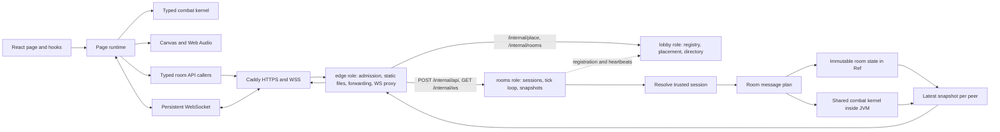

**简体中文** | [English](ARCHITECTURE.en.md) | [日本語](ARCHITECTURE.ja.md)

# 架构与代码审查指南

## 前端

`GamePage/index.tsx` 展示页面的主要区域。`useGame` 管理一个 `GameRuntime` 实例的完整生命周期，并让 React 订阅不可变的视图快照。当菜单或选人界面可见时，战斗区域仍保持 canvas 挂载，因此界面切换不会重建渲染器、输入监听器或动画循环。

前端责任划分遵循以下边界：

- `game/`：共享战斗规则、角色阵容、招式、领域类型、输入处理与模拟协议。浏览器与 Scala 的 GraalJS 适配器都使用它。
- `assets/`：应用层的清单加载、媒体类型与乐队美术查找。应用启动与页面展示使用同一模块；源素材保留在仓库根目录的 `assets/` 中，运行时素材保留在 `frontend/public/` 中。
- `apis/`：通用 HTTP 基础设施，每个已注册的房间消息各有一个调用方，另外还有持久的 `rooms/RoomConnection` 传输层。
- `pages/GamePage/runtime/`：命令式的浏览器系统。`GameRuntime` 让生命周期与帧顺序清晰可见；`audio/`、`input/`、`network/`、`display/` 与 `rendering/` 各自管理资源与清理。
- `pages/GamePage/components/`：可见区域。BattlePanel、CharacterSelection 与 LanLobby 的入口保持简洁，业务区域与局部 hook 就近放置。角色阵容、立绘、出场阵容与战斗规则控件仍由页面共享，因为本地与联机选人都要使用它们。简单组件保持平铺。
- `pages/GamePage/functions/` 与 `objects/`：页面共享的纯投影与展示类型。`buildBattleView` 把权威战斗数值投影出来，而不把可变的战士对象泄漏进 React。
- `components/ui/`：与应用无关的 UI 基础组件。

CharacterSelection 的 hook 协调其本地选人控制器、预览、设置与确认。LanLobby 的 hook 管理房间指令、令牌、禁选候选与待处理指令状态；它的展示组件只接收数据和回调。即使无关的更新先到达，一次成功的 HTTP 响应也不会解锁指令，直到对应的权威房间字段到达为止。BattlePanel 的展示 hook 管理全屏监听器与清理；它的入口直接展示关卡、HUD、操作与覆盖层。触屏操作用一个大型合并 J/K 按钮：轻点发送 J，按住 300 ms 发送 K 且不同时发送 J。一条直线进度条与重攻击美术显示按住状态。U/I/O 占据周围三个槽位，P 是右侧的中号按钮，L 位于底部摇杆旁边。待处理的手势在战斗、角色或形态变化时取消。它们的静态美术沿用现有动作帧与终结画面美术，跟随当前角色/形态；引用计数的图片缓存会释放未使用的图集，图标 canvas 只在美术或显示尺寸变化时重绘。指针捕获保证摇杆与攻击输入可以同时进行。摇杆保留无障碍的移动说明，但不显示可见标签或全屏指引。导航使用共享的无边框 Button，不带箭头装饰。

`GameRuntime` 协调输入、战斗、网络与效果适配器，`GameView` 承载展示快照。它的网络辅助模块负责有界预测、最新状态重放、可靠事件消费与诊断。`CanvasRenderer` 接收战斗状态但不修改它。`AudioDirector` 管理独立声道，并在销毁时释放音频资源。DOM 监听器、socket、动画帧与重连计时器都有清理逻辑。

严格模式 TypeScript 覆盖整个前端。另一份配置 `frontend/tsconfig.kernel.json` 在不引入 DOM 或环境浏览器类型的情况下检查全部共享战斗代码。`scripts/check-frontend-structure.mjs`（包含在 `npm run check` 中）检查 import 与 re-export：共享战斗代码保持自包含，传输层与素材层不能 import 页面内部实现，运行时不能 import React 区域，复杂区域之间不能互相触碰内部实现。共享 UI 基础组件与应用启动各有自己的依赖边界。

`game/engine.ts` 管理可序列化的对局状态与公开战斗 API。规则实现位于 `game/match/`，并显式接收所属的 `Match`。内核保留了一些非空断言，用于那些由标志位确立不变量的招式机制。

### 战斗审查地图

| 职责                                         | `frontend/src/game/` 下的实现                                   |
| -------------------------------------------- | --------------------------------------------------------------- |
| 对局状态、构造、固定步长累积与公开 API       | `engine.ts`                                                     |
| 单个 10 ms 步进与同时接触顺序                | `match/tick.ts`                                                 |
| 回合设置、击倒判定与接力资源结转             | `match/rounds.ts`                                               |
| 地形、落地、平台查询与身体分离               | `match/terrain.ts`                                              |
| 输入历史、指令选择与取消窗口                 | `match/commands.ts`                                             |
| 战士计时器、防御与输入缓冲                   | `match/fighter.ts`                                              |
| 招式合法性、资源消耗与攻击起手效果           | `match/bufferedAttack.ts`                                       |
| 跳跃、冲刺、移动与位置积分                   | `match/movement.ts`                                             |
| 命中、防御、反击、伤害与共鸣结算             | `match/hits.ts`                                                 |
| 飞行道具、召唤物与持续区域/控制效果          | `match/projectiles.ts`, `match/summons.ts`, `match/areas.ts`    |
| 变身退出与 CPU 寻路（乐队战术在 `band.ai`）  | `match/forms.ts`, `match/cpu.ts`                                |
| 世界常量、平铺角色阵容与共享属性缩放         | `data/rules.ts`, `data/roster.ts`                               |
| 目录组装、共享缩放/平衡处理与招式表路由      | `data/createMoveCatalog.ts`, `data/moves/`, `data/listMoves.ts` |
| 乐队契约、注册表、角色阵容、招式、形态与能力 | `bands/`（见 `docs/BANDS.md`）                                  |

`combatData.ts` 仍是共享目录的入口。`bands/` 下每个已注册乐队各自管理其角色阵容、本地招式组装、形态、招式表、指令表、取消规则、CPU 战术与平衡后调参。Mujica 与 MewType 不再把实现拆散在遗留目录中。共享分发使用 `bandFor(id)`。手工编写的招式位于各乐队的 `characters/<key>/<form>.ts`；乐队的 `shared/` 存放可复用的构造模板，`moves.ts` 保持注册顺序。Penguin 是高松灯（Tomori）的形态，Viola（薇欧拉）与其他 MewType 角色采用相同的虚拟形态布局。
`data/createMoveCatalog.ts` 让处理顺序清晰可见：合并各乐队的招式记录、注册 MyGO 的轻拳、应用共享移动缩放、注册连段、应用共享平衡、运行各乐队的 `tune`，最后校验目录。这些处理对每个目录各执行一次。乐队模块通过晚绑定的 `bands/shared/catalog.ts` 读取调参后的值，避免注册表循环依赖。Poppin'Party 的离线草案保持未注册。契约与新增乐队的配方见 `docs/BANDS.md`。

`objects/` 存放共享战斗结构。规则辅助函数不会给 `Match` 增加实例状态；快照字段、带种子的随机源与公开方法签名仍兼容本地对战、权威模拟与预测。

### 渲染审查地图

渲染代码属于 `pages/GamePage/runtime/rendering/`。`CanvasRenderer.ts` 负责加载图片、选择精灵图并做视觉校正。`createBattleScene.ts` 管理视觉状态的生命周期，并把当前对局提供给它的绘制辅助函数。

`battleScene/frame.ts` 展示图层顺序。附近的模块分别处理精灵图、事件到效果的转换、粒子生命周期、变身光环、长崎素世（Soyo）效果、进攻、防御、语音与 Mujica 技能。`battleScene/objects.ts` 定义相关的视觉状态与上下文。这些都是渲染器局部的值；绘制不会修改战斗状态。

`createProjectileRenderer.ts` 按基础、语音、Mujica 与 MewType 剪影分发到 `projectiles/`。`createStageRenderer.ts` 负责场景与地形绘制。各角色专属的 `draw*Skills.ts` 就近放在这些渲染器旁边。相机与手工姿态/动作选择位于渲染器旁的 `Camera.ts` 与 `animation/` 中。入场时序通过 `game/data/rules.ts` 共享；视觉入场配置保留在渲染器内部。页面协调、音频、输入与联网位于 `runtime/` 下；清单加载属于应用的素材模块。

## 后端

一个发布产物包含三个可部署角色以及共享系统基础设施。生产环境以独立的 systemd 单元运行 `SERVICE_ROLE=edge|lobby|rooms`；默认的 `all` 模式把同样的角色组合进一个 JVM，在环回地址后运行，用于本地调试。[后端服务](SERVICES.md) 是拓扑、内部契约、配置与故障行为的参考。

- `edge`：唯一的公开监听者。它提供静态文件与 `/api/health`，对房间创建、加入与 socket 握手施加按客户端的入住限制，把 `POST /api/{name}` 转发给所属的 rooms 实例，并桥接 `GET /ws?room=CODE` 的 WebSocket 帧。它维护一个短生命周期的房间码 → 实例缓存，不拥有任何房间状态。
- `lobby`：内部 `127.0.0.1:8079`。它根据 rooms 的心跳重建实例注册表与房间码目录，管理全局房间预算与放置预留，并为 edge 提供放置与所有者查询。它不持有持久状态，也不在战斗链路上。
- `rooms`：每个实例一个内部进程。它管理会话、房间成员、选人、就绪、加载屏障、对局生命周期、输入校验、120 Hz 房间循环与快照。它强制执行自己的 `MAX_ROOMS`，在每个房间受限的 GraalJS 上下文中运行共享战斗内核，并向 lobby 上报注册与心跳。
- `system`：`Main` 中的角色分发、静态文件服务、共享的 `OriginCheck`/`InternalGuard` 以及跨进程负载类型。房间消息框架（`APIMessage`、`APIMessageRouter`、`APIRegistration`）属于 `services/rooms`，因为只有该角色会执行房间消息。

跨进程负载类型位于 `services/system/objects/internal/`。内部端点要求对端来自环回地址；配置了 `INTERNAL_SECRET` 时还要求 `X-Mygo-Internal` 头。房间 API 调用从 edge 跨一次环回跳转；房间 tick 路径从不发起跨进程调用，因此 tick 循环、其信号量与内核都留在进程内。

HTTP 操作是 `final case class ...Message` 值，输入放在构造参数中，并提供 `plan(connection): IO[Response]`。每个前端操作在 `frontend/src/apis/rooms/` 下都有对应的调用方。注册名通过去掉 `Message` 并将类型名转为小写得到。Vite 在压缩时保留 API 类名。

`RoomRoutes.apiMessages` 只注册一次公开 HTTP 操作。`AttachRoomMessage`、`SubmitInputMessage` 与 `DisconnectRoomMessage` 等内部操作由 socket 边界使用，没有多余的 HTTP 端点或前端调用文件。rooms 进程在 `/internal/api` 与 `/internal/ws` 下内部暴露它们；edge 转发同样的公开协议，而不复制房间逻辑。顶层进程组合角色路由，而不是逐个列出 API。

rooms 路由在构造携带可信 `Session` 的消息之前先解析 bearer 令牌。客户端永远不能自行选择自己所在的玩家侧。仅主机可用的操作会检查那个可信的玩家侧。替换 socket 会使前一个对端失去提交输入的能力。

`RoomState` 不可变。它所属的 `Ref` 依次存放连续状态。每个房间一个 `Semaphore` 串行化指令与模拟调用，因此两次加入不会抢占同一个槽位，两条 JVM fiber 也不会同时进入同一个 GraalJS 上下文。不同房间可以并发推进。忙碌的房间会跳过自己的时钟迭代，因此准备新对局不会阻塞已有房间。rooms 运行时中的辅助函数使用 `private[rooms]` 可见性。

应用连接与房间运行时持有真实的 effect 资源。它们与可序列化的领域数据刻意分开。临时对局不需要 SQL、持久化层或只做转发的 service 层。lobby 的注册表与 edge 的所有者缓存都是有界内存结构，重启后重建；rooms 进程仍是活动房间状态的唯一所有者。

## 共享模拟

`scripts/build-simulation.mjs` 把 TypeScript 内核打包成 JVM 资源。Scala 的 `Simulation` 适配器创建一个私有 GraalJS 上下文，不允许宿主访问或类查找。它只接收经过校验的输入与配置。后端不会执行客户端提供的代码。

服务器只在双方客户端确认当前代次后才开始对局。输入携带递增的序列号与每个动作的按下计数。短按会被锁存，直到某个模拟 tick 消费它，即使松开事件先到达也是如此。过期的序列会被忽略。重启、暂停与回合切换会释放待处理输入。

浏览器在服务器数据包之间进行预测，以便立即显示本地移动。每个权威数据包都会替换预测模型，同时保留战士对象标识以维持视觉动画。预测事件会被丢弃；只有服务器事件才会触发联机音效与视频。在没有新权威数据包的情况下，预测会在 100–250 ms 的视界后停止，具体依据平滑后的往返时间。伤害、资源、胜负与回合切换由服务器决定。

## 素材与清理

前端外壳是一个小型 Vite 构建。`assets.json` 引用按内容寻址的媒体文件。选中的战斗图片会在开战前解码并预热；未变更的媒体会收到不可变缓存头。原始图集与署名保留在 `assets/` 下，供可选的美术流程使用。MyGO 的图集按 `assets/characters/mygo/<character>/` 分组；[素材清单](../assets/README.md) 说明归属与路径约定。

原先内嵌的 HTML 文件、全局脚本运行时、Node 局域网服务器、过时的浏览器脚本与生成的截图历史已被移除。Git 历史保留了旧实现。`.idea/` 与生成的构建产物已被忽略。
