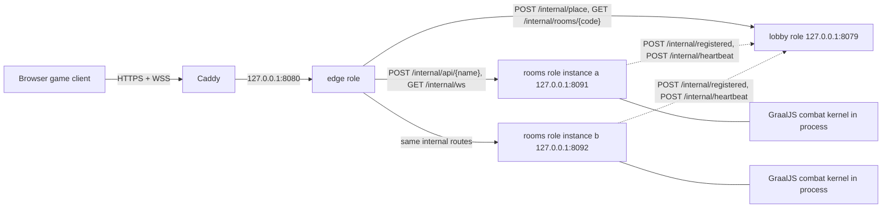

[简体中文](SERVICES.md) | [English](SERVICES.en.md) | **日本語**

# バックエンドサービス

Scala バックエンドは、1 つのリリース成果物から 3 つのロール —— `edge`、`lobby`、`rooms` —— として動作します。本番環境では各ロールをそれぞれ独立した systemd ユニットとして起動します。ローカルランチャー（`npm run lan`）は、同じ 3 つのロールをループバック上で 3 つの JVM として起動します。起動時に `SERVICE_ROLE` がロールを選択し、パッケージ済みの `bin/mygo-server` エントリーポイントは変わりません。

この分割は、公開側の受け入れ、ディレクトリ、ルーム実行をそれぞれ独立してスケールさせるために 2026-10-29 に採用しました。権威ある戦闘 tick ループは意図的に 1 つのプロセス内に留めています。[レイテンシ予算と tick ループ](#レイテンシ予算と-tick-ループ)を参照してください。

## トポロジー



公開向けアドレスを待ち受けるのは edge だけです。Caddy はこれまで通り HTTPS と WSS を `127.0.0.1:8080` へ転送するため、公開プロキシの設定は変わりません。edge/lobby/rooms 間の呼び出しはすべてループバック HTTP で、共有の `INTERNAL_SECRET` が設定されている場合はそれを提示する必要があります。rooms インスタンスは lobby へ登録とハートビートを送りますが、edge を呼び出すことはありません。edge がルーム状態を保持することもありません。

## ロールの責務

| ロール   | 待ち受け                                       | 担当                                                                                                                                                             | 担当しない                                                   |
| -------- | ---------------------------------------------- | ---------------------------------------------------------------------------------------------------------------------------------------------------------------- | ------------------------------------------------------------ |
| `edge`   | 公開 `HOST:PORT`                               | 静的ファイル、`/api/health`、クライアント単位の受け入れカウンター、同一オリジンチェック、公開 API メッセージの転送、WebSocket プロキシ、owner キャッシュ         | ルーム状態、セッション、配置、戦闘シミュレーション           |
| `lobby`  | 内部 `LOBBY_HOST:LOBBY_PORT`                   | グローバルなルーム予算、ハートビートからのインスタンス登録表、ルームコードディレクトリ、配置/予約、グローバル `MAX_ROOMS`                                        | プレイヤーソケット、ルームメッセージ、戦闘、スナップショット |
| `rooms`  | インスタンスごとの内部 `ROOMS_HOST:ROOMS_PORT` | ルームのライフサイクル、セッション、メンバーシップ、選択/準備/ライフサイクル、戦闘カーネル、120 Hz tick ループ、スナップショット、インスタンスごとの `MAX_ROOMS` | 公開 HTTP、WebSocket、配置、グローバルなルーム予算           |
| `system` | なし                                           | ロールのディスパッチ（`Main`）、静的配信、`OriginCheck`/`InternalGuard`、`objects/internal/` 配下のプロセス間ペイロード型                                        | ルームメッセージ、ルーム API 登録、ビジネス状態              |

`services/system/objects/internal/` は、プロセス間で共有するペイロード型の唯一の置き場所です。`PlacementResult`、`RoomOwnerResult`、`RegisteredRoom`、`InstanceSummary`、`RoomSummary`、`InternalError` がここにあります。内部エンドポイントは `services/system/routes/InternalGuard` で保護されるため、呼び出し側はループバック経由で到達し、`INTERNAL_SECRET` が設定されている場合は `X-Mygo-Internal: <secret>` を提示する必要があります。

## リリースとロール選択

`backend/build.sbt` は、すべてのロールを含む 1 つの `mygo-server-2.0.0.tgz` をパッケージします。起動時に `services/system/api/Main.scala` が `SERVICE_ROLE` を読みます：

| 値            | 動作                                                                                                                                |
| ------------- | ----------------------------------------------------------------------------------------------------------------------------------- |
| `edge`        | 公開 edge ロールだけを起動します。                                                                                                  |
| `lobby`       | 内部 lobby ロールだけを起動します。                                                                                                 |
| `rooms`       | 内部 rooms インスタンスを 1 つ起動します。`INSTANCE_ID`、`INSTANCE_URL`、ポートで識別します。                                       |
| `all`（既定） | 1 つの JVM 内で lobby、rooms、edge をループバックの背後に構成します。ローカルデバッグとレイテンシ比較用で、デプロイには使いません。 |
| それ以外の値  | `Unsupported SERVICE_ROLE: ...` で起動に失敗します。                                                                                |

デプロイされるユニットは `mygo-edge.service`、`mygo-lobby.service`、そしてインスタンステンプレート `mygo-rooms@.service`（`%i` は rooms インスタンス ID）です。[デプロイとロールバック](#デプロイとロールバック)を参照してください。

## 内部サービス契約

以下のパスはすべて `/internal` で始まり、ループバック経由でのみ到達できます。`INTERNAL_SECRET` が設定されている場合、一致する `X-Mygo-Internal` ヘッダーのないリクエストは `403` と `{"error":"内部接口不允许外部访问"}` で拒否されます。

| エンドポイント               | 呼び出し元 → 呼び出し先                          | リクエストボディ                                                           | 成功                      | 失敗                                                                         |
| ---------------------------- | ------------------------------------------------ | -------------------------------------------------------------------------- | ------------------------- | ---------------------------------------------------------------------------- |
| `POST /internal/place`       | edge → lobby                                     | `{}`（ボディは無視されます）                                               | `200` `PlacementResult`   | `503` `InternalError` のルーム満室メッセージ。edge は転送失敗を `502` に変換 |
| `GET /internal/rooms/{code}` | edge → lobby                                     | なし。`code` パスセグメントは大文字に正規化されます                        | `200` `RoomOwnerResult`   | `404` `InternalError` のルーム不在メッセージ                                 |
| `POST /internal/registered`  | rooms → lobby                                    | `RegisteredRoom`                                                           | `204`                     | rooms はこの呼び出しをベストエフォートとして扱い、結果を無視します           |
| `POST /internal/heartbeat`   | rooms → lobby                                    | `InstanceSummary`（インスタンスの識別情報、容量、現在のルーム）            | `204`                     | rooms はこの呼び出しをベストエフォートとして扱い、結果を無視します           |
| `POST /internal/api/{name}`  | edge → rooms                                     | 公開 JSON ボディはそのまま。`createroom` は `{"code":"ABC123"}` に書き換え | `200` 公開レスポンス      | `400` 不正なリクエスト、`404` 不明な名前、`429`（`Retry-After` は保持）      |
| `GET /internal/ws?room=CODE` | edge → rooms                                     | WebSocket アップグレード。ルームコードのクエリが owner のルーティングキー  | `101` アップグレード      | ルーム/owner が見つからない場合はエラーフレームで切断。ルーム不一致は拒否    |
| `GET /internal/health`       | edge → lobby/rooms、activate/rollback → 各ロール | なし                                                                       | `200` ロールのヘルス JSON | 200 以外またはタイムアウトは依存先を利用不可として扱います                   |

ペイロードボディ：

| 型                | JSON                                                                                                            |
| ----------------- | --------------------------------------------------------------------------------------------------------------- |
| `PlacementResult` | `{"instanceId":"a","instanceUrl":"http://127.0.0.1:8091","code":"A1B2C3"}`                                      |
| `RoomOwnerResult` | `{"instanceId":"a","instanceUrl":"http://127.0.0.1:8091"}`                                                      |
| `RegisteredRoom`  | `{"code":"A1B2C3","instanceId":"a"}`                                                                            |
| `InstanceSummary` | `{"instanceId":"a","instanceUrl":"http://127.0.0.1:8091","capacity":4,"rooms":[{"code":"A1B2C3","players":2}]}` |
| `InternalError`   | `{"error":"..."}`                                                                                               |

ロールのヘルスボディ：

| ロール  | ボディ                                                                                                                |
| ------- | --------------------------------------------------------------------------------------------------------------------- |
| `lobby` | `{"role":"lobby","ok":true,"instances":1,"rooms":1}`                                                                  |
| `rooms` | `{"role":"rooms","instanceId":"a","rooms":1,"ok":true}`                                                               |
| `edge`  | `{"app":"mygo-scala","ok":true,"tickHz":120,"snapshotHz":60,"services":{"edge":"ok","lobby":"ok","rooms":"unknown"}}` |

edge のヘルスボディは、設定とプローブ結果に応じて各依存先を `ok`、`down`、`unknown`、`disabled` として報告します。短いタイムアウトで `LOBBY_URL` を、設定されている場合は `ROOMS_DIRECT_URL` をプローブします。すべてのルームを lobby 経由でルーティングするデプロイでは、通常 `rooms` は `unknown` と報告されます。これはエンドポイントの失敗ではありません。アクティベーションスクリプトは、内部ヘルスボディの `"ok":true` と、公開 edge ボディの `"app":"mygo-scala"` を確認します。

配置とディレクトリの動作：

- lobby は 1 つの許可で配置を直列化するため、同時実行の作成は同じ予算スナップショットを参照します。ルームが配置されるのは、ディレクトリと有効な予約の合計がグローバル `MAX_ROOMS` を下回り、かつ選択されたインスタンスの報告済みルームと予約の合計が `min(ROOMS_PER_INSTANCE, capacity)` を下回るときだけです。
- 負荷が最も低い稼働インスタンスが選ばれ、同値の場合は `instanceId` で決着します。稼働インスタンスとは、最後のハートビートが `INSTANCE_TTL_MS` より新しいインスタンスです。
- コードは安全な乱数 3 バイトを 6 文字の大文字 16 進数（`ABC123`）として表現したもので、ディレクトリと予約に対して最大 5 回まで再試行します。
- 配置は短期の予約（`RESERVATION_TTL_MS`）を作成し、rooms インスタンスが新しいルームを報告するまでの間を埋めます。owner 検索は有効な予約を受け入れるため、ホストの最初の後続リクエストは次のハートビートより前に成功できます。
- ハートビートはコードからインスタンスへのディレクトリを再構築し、報告したインスタンスが確認済みの予約を消去します。lobby の 1 秒ごとのループは、古いインスタンス、そのディレクトリエントリ、期限切れの予約を破棄します。

rooms 側：

- rooms インスタンスは `HEARTBEAT_INTERVAL_MS`（既定 2000 ms）ごとに、自身と現在のルームを lobby へ報告します。`LobbyClient` は短い内部タイムアウトを使い、失敗を握りつぶします。lobby が利用できない間も、ルーム作成と戦闘は動作し続ける必要があるためです。
- `CreateRoomMessage` は edge の配置から任意の 6 桁 16 進コードを受け取り、なければインスタンスが自分でコードを生成します。インスタンスは自身の `MAX_ROOMS` を適用し、共有のルーム満室メッセージを報告します。
- 内部 API ルーターは公開プロトコルと同じ登録とボディ上限を適用します。edge はルームメッセージにとって透過的なトランスポートです。

## 公開 API ルーティング

Caddy が TLS を終端し、その後 edge がすべての公開リクエストを処理します：

| リクエスト               | edge の動作                                                                                                                                                                                                       | 応答または転送する主体 |
| ------------------------ | ----------------------------------------------------------------------------------------------------------------------------------------------------------------------------------------------------------------- | ---------------------- |
| `GET /api/health`        | ローカルヘルス。短いタイムアウトで `LOBBY_URL` を、設定されている場合は `ROOMS_DIRECT_URL` をプローブ                                                                                                             | edge                   |
| `POST /api/createroom`   | クライアントあたり毎分 20 リクエストで受け入れ。lobby にコードの配置を依頼し、`{"code":...}` を付けて所有する rooms インスタンスへ転送します。一時的な配置または転送応答（HTTP 400/503）では 1 回だけ再試行します | lobby、その後 rooms    |
| `POST /api/joinroom`     | 毎分 20 リクエストで受け入れ。ボディから `code` を読み、3 秒の owner キャッシュまたは lobby から所有インスタンスを解決し、ボディをそのまま転送します                                                              | lobby、その後 rooms    |
| `POST /api/{name}`       | その他の登録済みルームメッセージ向け。トークンのプレフィックス（`ABC123.<48 hex>`）から 6 桁 16 進コードを読み、owner を解決し、ボディをそのまま転送します                                                        | lobby、その後 rooms    |
| `GET /ws?room=CODE`      | クライアントあたり毎分 60 ハンドシェイクで受け入れ。同一オリジンチェック、owner 検索の後、所有する rooms インスタンスへ双方向 WebSocket プロキシを行います                                                        | lobby、その後 rooms    |
| `GET /*`（その他のパス） | `WEB_ROOT` から静的ファイルを配信します。`media/` と `assets/` は 1 年間不変、それ以外は `no-cache` です。`api/` と `ws` がファイルとして配信されることはありません                                               | edge                   |

登録済みのルームメッセージとその公開エンドポイント：

| メッセージ型         | `POST /api/...` | アイデンティティ                                                 |
| -------------------- | --------------- | ---------------------------------------------------------------- |
| `CreateRoomMessage`  | `createroom`    | なし。ホストセッションを作成します。                             |
| `JoinRoomMessage`    | `joinroom`      | なし。6 桁 16 進のルームコードで参加し、セッションを作成します。 |
| `ChooseRoomMessage`  | `chooseroom`    | 信頼済みセッショントークン。ホストが共有ルーム設定を制御します。 |
| `ReadyRoomMessage`   | `readyroom`     | 信頼済みセッショントークン。                                     |
| `LoadedRoomMessage`  | `loadedroom`    | 信頼済みセッショントークン、generation、接続済み peer。          |
| `PauseRoomMessage`   | `pauseroom`     | 信頼済みセッショントークン。                                     |
| `RestartRoomMessage` | `restartroom`   | 信頼済みセッショントークン。ホストのみ。                         |
| `FinishRoomMessage`  | `finishroom`    | 信頼済みセッショントークンと表示 tick。                          |
| `LobbyRoomMessage`   | `lobbyroom`     | 信頼済みセッショントークン。                                     |
| `LeaveRoomMessage`   | `leaveroom`     | 信頼済みセッショントークン。セッションを失効させます。           |

`AttachRoomMessage`、`SubmitInputMessage`、`DisconnectRoomMessage`、`ResolveSessionMessage` は rooms プロセスとソケット境界の内部に留まります。公開 HTTP エンドポイントもフロントエンドの呼び出しファイルもありません。

edge の失敗マッピングと制限：

- 不明なルーム：`joinroom` はルーム不在メッセージとともに `400` を返します。その他のメッセージはルーム期限切れメッセージとともに `400` を返します。
- owner キャッシュは有界（4096 コード）で、`ROOM_CACHE_TTL_MS` の後に失効します。5 秒ごとにスイープが走ります。
- lobby または rooms への転送失敗は `502` に、内部タイムアウトは `504` にマッピングされます。ルーム満室の `503` や `Retry-After` 付きの `429` を含むその他の上流応答は、そのステータスとボディのまま通過します。有効な `room` クエリのないソケットハンドシェイクの拒否は `400` と `缺少房间码` を返します。
- 公開 API リクエストは 8 KiB に制限されます。より大きいボディは所有サービスに到達する前に拒否されます。ブラウザの同一オリジンリクエストは強制されます（`Origin` の権限が `Host` と一致する必要があります）。
- 受け入れカウンターはクライアントアドレス単位（`TRUST_LOCAL_PROXY=true` の場合はループバックプロキシからの最後の `X-Forwarded-For` アドレス）で、1 分後に失効し、アドレス/カテゴリのエントリは最大 4096 件です。拒否は `429`、`Retry-After: 60`、中国語の再試行メッセージです。
- `LOBBY_URL` がない場合、edge はルーム作成とすべての owner 検索を `ROOMS_DIRECT_URL` へ転送します。その場合 rooms インスタンスが自分でルームコードを生成します。このフォールバックは単一インスタンスのデバッグ構成向けで、デプロイされるトポロジーではありません。

## ルームコード、トークン、プロトコル 25

- WebSocket ハンドシェイクのプロトコルは **25** です。サーバーは他のバージョンを `客户端与主机版本不一致，请房主重启联机服务，双方刷新页面。` で拒否します。
- ルームトークンは `<6 桁の大文字 16 進コード>.<48 桁の 16 進文字>` で、たとえば `A1B2C3.` の後に 48 桁の 16 進数が続きます。コードは所有インスタンスを識別し、48 桁の接尾辞は 24 バイトのランダムなセッション秘密鍵です。
- クライアントは `SessionResponse`（`token`、`side`、`room`）でトークンを受け取り、タブスコープのセッションストレージに保持します。認証が必要な HTTP メッセージと socket の `authenticate` メッセージがトークンを運びます。トークンが URL に現れることはありません。
- WebSocket URL が運ぶのは共有可能なルームコードだけです：`GET /ws?room=CODE`。その後 socket はトークンと同じプロトコルバージョンで認証する必要があります。クエリのコードがトークンのルームと一致しない場合、サーバーはルーム期限切れメッセージを返します。
- edge は何かを転送する前にルームコードを必要とするため、コードは 2 回エクスポートされます。HTTP メッセージ用のトークンプレフィックスとして、そして socket 用の `?room=` クエリとしてです。これがプロトコル 24 以前のクライアントが非互換である理由です。それらのトークンにはコードのプレフィックスがなく、socket はルームクエリなしで `/ws` に接続していました。
- ルームコードは秘密ではありません。プレイヤーは参加のために共有します。トークンは資格情報です。ルームコマンドが実行される前に、ルーターバウンダリで信頼済みセッションへ検証されます。
- 既存のクライアントはデプロイ後にリロードする必要があります。これまで通り、サーバーの再起動もすべての一時ルームを終了させます。

## 設定マトリクス

すべてのロールが環境変数を読みます。デプロイでは、ユニットに共有の `SERVICE_ROLE=...` を、そして `/etc/mygo-fighter/{base,edge,lobby,rooms}.env` と任意のインスタンス別 `rooms-<id>.env` に以下の値を加えます。ローカルランチャーは同じ変数を直接構築します。

| 変数                      | ロール       | 既定値                           | ルールと意味                                                                                                                                   |
| ------------------------- | ------------ | -------------------------------- | ---------------------------------------------------------------------------------------------------------------------------------------------- |
| `SERVICE_ROLE`            | すべて       | `all`                            | `edge`、`lobby`、`rooms`、`all`。それ以外の値は起動に失敗します。                                                                              |
| `INTERNAL_SECRET`         | すべて       | 未設定                           | 共有の内部呼び出し秘密鍵。設定すると、すべての edge/lobby/rooms 内部 HTTP 呼び出しがこれを提示する必要があります。インストーラーが生成します。 |
| `HOST`                    | edge         | `127.0.0.1`                      | 公開バインドアドレス。LAN ランチャーは `0.0.0.0` を使います。                                                                                  |
| `PORT`                    | edge         | `8080`                           | 公開ポート、1–65535。                                                                                                                          |
| `WEB_ROOT`                | edge         | `../frontend/dist`               | 静的ファイルのルート。パッケージデプロイでは `/srv/mygo-fighter/current/web` を使います。                                                      |
| `LOBBY_URL`               | edge, rooms  | 未設定                           | 配置/owner 検索（edge）とハートビート（rooms）用の lobby ベース URL。                                                                          |
| `ROOMS_DIRECT_URL`        | edge         | 未設定                           | lobby が構成されていない場合にのみ使う直接の rooms URL。                                                                                       |
| `TRUST_LOCAL_PROXY`       | edge         | `false`                          | ループバックプロキシの背後でのみ `true`。最後の `X-Forwarded-For` アドレスを受け入れます。                                                     |
| `ROOM_CACHE_TTL_MS`       | edge         | `3000`                           | ルーム owner キャッシュエントリの寿命。最小 250。                                                                                              |
| `OWNER_LOOKUP_TIMEOUT_MS` | edge         | `300`                            | lobby の owner 検索タイムアウト。最小 50。                                                                                                     |
| `FORWARD_TIMEOUT_MS`      | edge         | `10000`                          | rooms インスタンスへの転送タイムアウト。最小 1000。                                                                                            |
| `WS_QUEUE_FRAMES`         | edge         | `64`                             | 接続ごとの有界プロキシキュー。最小 8。                                                                                                         |
| `LOBBY_HOST`              | lobby        | `127.0.0.1`                      | lobby のバインドアドレス。内部専用。                                                                                                           |
| `LOBBY_PORT`              | lobby        | `8079`                           | lobby ポート、1–65535。                                                                                                                        |
| `MAX_ROOMS`               | lobby, rooms | `4`                              | lobby：グローバル上限。rooms：このインスタンスの上限。正の値。                                                                                 |
| `ROOMS_PER_INSTANCE`      | lobby        | `MAX_ROOMS` と同じ               | インスタンスあたりの配置上限。正の値で `MAX_ROOMS` 以下。                                                                                      |
| `INSTANCE_TTL_MS`         | lobby        | `6000`                           | この値を超えたハートビート経過でインスタンスを破棄。最小 2000。                                                                                |
| `RESERVATION_TTL_MS`      | lobby        | `10000`                          | 配置予約の寿命。最小 2000。                                                                                                                    |
| `ROOMS_HOST`              | rooms        | `127.0.0.1`                      | rooms のバインドアドレス。内部専用。                                                                                                           |
| `ROOMS_PORT`              | rooms        | `8091`                           | rooms ポート、1–65535。インスタンス a は 8091、インスタンス b は 8092。                                                                        |
| `INSTANCE_ID`             | rooms        | `a`                              | 小文字、数字、ハイフン。テンプレートインスタンスが提供します。                                                                                 |
| `INSTANCE_URL`            | rooms        | `http://$ROOMS_HOST:$ROOMS_PORT` | lobby へ報告し、edge が転送に使う URL。                                                                                                        |
| `HEARTBEAT_INTERVAL_MS`   | rooms        | `2000`                           | 登録/ハートビートの周期。最小 250。                                                                                                            |

デプロイされるユニットの制限：

| ロール  | ユニット              | `JAVA_OPTS`                                                                                                          | MemoryMax | キャッシュ                         |
| ------- | --------------------- | -------------------------------------------------------------------------------------------------------------------- | --------- | ---------------------------------- |
| `edge`  | `mygo-edge.service`   | `-Xms16m -Xmx80m -XX:ReservedCodeCacheSize=32m -XX:MetaspaceSize=96m -Xss512k`                                       | 256M      | なし                               |
| `lobby` | `mygo-lobby.service`  | `-Xms16m -Xmx48m -XX:ReservedCodeCacheSize=24m -XX:MetaspaceSize=96m -Xss512k`                                       | 192M      | なし                               |
| `rooms` | `mygo-rooms@.service` | `-Xms128m -Xmx256m -XX:ReservedCodeCacheSize=128m -XX:MetaspaceSize=96m -Dpolyglot.engine.WarnInterpreterOnly=false` | 512M      | `/var/cache/mygo-fighter/rooms-%i` |

これらの上限は、2 vCPU・約 1.6 GiB のホストで [2026-10-30 のゲームプレイ監査](DEPLOYMENT_2026-10-30.ja.md)の際に選定したもので、同監査では 2 ルームの公開上限も選定しています。これらはリソース制限であり、あらゆるワークロードに対する保証ではありません。`MAX_ROOMS` を引き上げる前に、`systemctl show` とデプロイ時のチェックで確認してください。

## 障害モードとグレースフルデグラデーション

| 障害                                          | 影響                                                                                                                                                                                                                  | 復旧                                                                                                  |
| --------------------------------------------- | --------------------------------------------------------------------------------------------------------------------------------------------------------------------------------------------------------------------- | ----------------------------------------------------------------------------------------------------- |
| lobby が利用できない                          | 新しいルーム作成を配置できないため、edge は `502` を返します。既存のルームは動作を続け、キャッシュされた所有権でルーティング済みのコマンドはキャッシュ TTL まで有効です。rooms のハートビートは無害に破棄されます。   | lobby を再起動します。インスタンスは 1 ハートビート周期以内に再登録し、ディレクトリが再構築されます。 |
| rooms インスタンスが利用できない              | そのインスタンスのルームは失われます（一時的な状態）。lobby は `INSTANCE_TTL_MS` の後にそのインスタンスを破棄します。キャッシュエントリが失効するまで、edge が古いキャッシュ owner からのエラーを返すことがあります。 | インスタンスを再起動します。自身を再登録します。新しいルーム向けの容量が戻ります。                    |
| edge が利用できない                           | 公開サイトと API には到達できませんが、lobby と rooms は状態を保ち、アイドル状態のルームも tick を続けます。                                                                                                          | edge を再起動します。クライアントは保存済みのセッションで再接続します。                               |
| すべてが再起動                                | これまで通り、すべての一時ルームとセッションが破棄されます。                                                                                                                                                          | クライアントがルームを作成または参加し直します。                                                      |
| `INTERNAL_SECRET` がない                      | 内部エンドポイントはループバック専用のままですが、共有ヘッダーは要求されません。                                                                                                                                      | インストーラーが生成した秘密鍵を使います。設定して各ロールを再起動します。                            |
| 内部秘密鍵の不一致                            | すべてのプロセス間呼び出しが `403` で拒否され、起動がヘルスチェックを通過しません。                                                                                                                                   | すべてのユニットで 1 つの `/etc/mygo-fighter/base.env` を共有します。                                 |
| グローバルなルーム予算に到達                  | lobby がルーム満室メッセージを返し、公開の作成はサーバー満員として報告されます。                                                                                                                                      | ルームを解放するか期限切れを待つか、意図的に `MAX_ROOMS` を引き上げます。                             |
| インスタンスあたりのルーム予算に到達          | rooms インスタンスがルーム満室メッセージで作成を拒否します。                                                                                                                                                          | 既存のルームに参加するか、別の稼働インスタンスに配置します。                                          |
| 受け入れ制限に到達                            | そのクライアントアドレスからの作成/参加または socket ハンドシェイクに `429` と `Retry-After: 60` を返します。                                                                                                         | 1 分間のウィンドウを待ちます。                                                                        |
| 1 つの rooms JVM 内での戦闘カーネルクラッシュ | ユニットが再起動し、そのインスタンスのルームは失われ、lobby へ再登録します。                                                                                                                                          | クライアントが再接続して作成または参加し直します。                                                    |

lobby は永続状態を持ちません。`mygo-lobby` はいつでも再起動でき、ルームのハートビートからディレクトリを再構築します。edge が保持するのは有界のキャッシュと受け入れカウンターだけです。rooms プロセスが生きたルーム状態の唯一の所有者です。

## レイテンシ予算と tick ループ

プロセス境界をまたぐ応答はリクエストパスに限定されます：

- ルーム作成は lobby の配置呼び出し 1 回（500 ms の内部タイムアウト）と、rooms インスタンスへの転送 1 回（`FORWARD_TIMEOUT_MS`、既定 10 秒）を追加します。
- 参加とその他のルームメッセージは、owner 検索を最大 1 回追加します。まずメモリキャッシュ、なければ `OWNER_LOOKUP_TIMEOUT_MS`（既定 300 ms）での lobby 呼び出しです。成功した検索は `ROOM_CACHE_TTL_MS`（既定 3 秒）までキャッシュされます。
- 最後の `loadedroom` 確認応答は GraalJS コンテキストも初期化します。最低 60 秒の転送予算と 65 秒のブラウザ予算があり、コールドスタートがサービスの失敗と誤認されないようにしています。他の API の予算は変わりません。
- socket トラフィックは再シリアライズせずに、有界キュー（`WS_QUEUE_FRAMES`、既定 64）を通して WebSocket フレームとしてプロキシされます。キューが満杯になると、無制限にバッファリングする代わりにプロキシ接続を閉じます。
- これらは有界の失敗予算であり、想定されるネットワークレイテンシではありません。内部呼び出しはループバック HTTP で、戦闘クロックのパス上に内部呼び出しは現れません。

権威ある tick ループは 1 つの rooms プロセス内に留まります：

- カーネルは 120 Hz のルームループ（1 反復 8.33 ms）上で固定 10 ms 刻みに進み、毎秒 60 個のアクティブスナップショットを目標とします。各ルームは 1 つのセマフォで保護されるため、コマンドとシミュレーションが同じルームの GraalJS コンテキストへ同時に入ることはありません。ルームごとのコンテキストはプロセスローカルで、JVM 間で共有できません。
- tick ループを複数プロセスに分割すると、毎反復に同期的な内部往復と状態のシリアライズが加わるか、状態の複製とプロセス間ロックが必要になります。その作業は 8.33 ms の期限の相当な割合を消費し、ルームの権威も曖昧にします。現行設計でも、グローバルなバッチなしに別々のルームが独立して進んでいます。
- したがって rooms の tick パスがプロセス間呼び出しを行うことはありません。ルーム登録とハートビートは短いタイムアウトを持つバックグラウンドファイバーで、ベストエフォートであり tick をブロックしません。プロセス間ペイロード型は `services/system/objects/internal/` 配下にあり、`AGENTS.md` にその規則が記載されています。
- [2026-10-27 のスケーリング記録](BACKEND_SCALING_2026-10-27.ja.md)は、同一マシンの 8 ルーム・ループバックのワークロードを測定しています。スケジューリング変更後、戦闘のサーバー更新 p95 は 1.74 ms、スナップショット到着間隔 p95 は 29.37 ms、入力の送信から受信まで p95 は 29.16 ms でした。これらの数値はそのワークステーションでの実行を表すもので、ホスト容量やインターネットレイテンシの保証ではありません。ルームループの周期、アイドル間隔、スナップショット方針、追いつき上限は[LAN プロトコルとパフォーマンス](LAN.ja.md)で説明しています。

## デプロイとロールバック

リリース成果物は `npm run package:server` が生成する `backend/target/universal/mygo-server-2.0.0.tgz` です。デプロイファイルは `deploy/` にあります：

| ファイル                       | 目的                                                                       |
| ------------------------------ | -------------------------------------------------------------------------- |
| `deploy/mygo-edge.service`     | 公開 edge ユニット。                                                       |
| `deploy/mygo-lobby.service`    | 内部 lobby ユニット。                                                      |
| `deploy/mygo-rooms@.service`   | rooms テンプレートユニット。インスタンス ID は `%i`。                      |
| `deploy/env/base.env.example`  | 共有の `INTERNAL_SECRET` と `ROOMS_INSTANCES`。                            |
| `deploy/env/edge.env.example`  | 公開 edge の設定。                                                         |
| `deploy/env/lobby.env.example` | グローバルなルーム予算とディレクトリ設定。                                 |
| `deploy/env/rooms.env.example` | インスタンス別の rooms 設定。インスタンス別の上書きは `rooms-<id>.env`。   |
| `deploy/server.env.example`    | 旧単一ユニットの設定。移行メモ付きで保持しています。                       |
| `deploy/install.sh`            | 初回のホストインストール：ユニット、環境ファイル、秘密鍵、Caddy。          |
| `deploy/activate.sh`           | ヘルスチェックとロールバックを伴うセット全体のリリースアクティベーション。 |
| `deploy/rollback.sh`           | 保持している直前のリリースへのセット全体のロールバック。                   |
| `deploy/Caddyfile`             | `127.0.0.1:8080` へのリバースプロキシ。変更なし。                          |

初回インストールは、公開ホスト名を指定して root で実行します：

```sh
sudo bash deploy/install.sh PUBLIC_HOSTNAME
```

インストーラーは `mygo` アカウントと `/srv/mygo-fighter/releases` を作成し、3 つのユニットとホスティングスクリプトを `/opt/mygo-fighter` 配下にインストールし、`/etc/mygo-fighter/{base,edge,lobby,rooms}.env` を存在しない場合にのみ作成し、秘密鍵がない場合は生成した 64 文字の 16 進 `INTERNAL_SECRET` を追記し、`ROOMS_INSTANCES` の各インスタンスに対して `caddy`、`mygo-edge`、`mygo-lobby`、`mygo-rooms@<id>` を有効化します。Caddy の既存の安全動作を保ち、冪等です。旧 `mygo-fighter.service` が残るホストでは、2 つの構成がポート 8080 を奪い合わないようにそのユニットを無効化して停止し、移行手順を表示します。`/etc/mygo-fighter.env` は保持されますが、読み込まれなくなります。

アクティベーションはリリースを展開し、`bin/mygo-server` と `web/index.html` を検証してから、ロールのセット全体を置き換えます：

```sh
sudo bash /opt/mygo-fighter/activate.sh ARCHIVE RELEASE_ID [COMMIT]
```

1. ホストローカルのデプロイロックで直列化します。
2. `mygo-edge`、次に `mygo-lobby`、最後に各 `mygo-rooms@<id>` インスタンスを停止します。
3. `/srv/mygo-fighter/current` を新しいリリースへアトミックに切り替えます。
4. 各 rooms インスタンス、次に lobby、最後に edge を起動します。
5. 各 rooms と lobby の `/internal/health` が `"ok":true` を報告し、`edge /api/health` が `"app":"mygo-scala"` を報告するまで待ちます。
6. アクティブなリリースに `deployment.json` を書き込みます。リリース ID、任意のコミット、アーカイブの SHA-256、アクティベーション時刻、各ロールのホストとポート、rooms インスタンスの一覧です。
7. 置き換えたリリースを `/srv/mygo-fighter/previous` に保持します。

切り替え、起動、ヘルスチェックのいずれかが失敗すると、直前のリリースを復元してセット全体を再起動します。`sudo bash /opt/mygo-fighter/rollback.sh` は同じ停止・起動・ヘルスチェックの順序で active と previous のリンクを反転し、ロールバック自体が失敗した場合はアクティブなリリースを復元します。デプロイとロールバックはどちらも各ロールを停止するため、リリースの切り替えは一時ルームを終了させ、両方のプレイヤーがリロードする必要があります。

Caddy のリバースプロキシは `https://PUBLIC_HOSTNAME` → `127.0.0.1:8080` のままで、そのポートを待ち受けるのは edge だけです。ホストの準備、ポート規則、運用コマンドは[公開オンラインホスティング](WAN.ja.md)を参照してください。

## ローカル 3 プロセス構成

`npm run lan` はコマンドとして変わりません。ランチャーはフロントエンドをビルドして同じ JVM 成果物をステージングし、ループバック上で 3 つのロールプロセスを起動します：

| プロセス | ロール  | ポート | 主要な環境変数                                                   |
| -------- | ------- | ------ | ---------------------------------------------------------------- |
| 1        | `rooms` | 8091   | `ROOMS_PORT=8091`、`INSTANCE_ID=a`、`MAX_ROOMS=PUBLIC MAX_ROOMS` |
| 2        | `lobby` | 8079   | `LOBBY_PORT=8079`、グローバル `MAX_ROOMS`、`ROOMS_PER_INSTANCE`  |
| 3        | `edge`  | 8080   | `HOST`（既定 `0.0.0.0`）、`PORT`、`WEB_ROOT`、`LOBBY_URL`        |

LAN 対戦では `MAX_ROOMS` の既定値は 20 です。`INTERNAL_SECRET`、`TRUST_LOCAL_PROXY`、`HEARTBEAT_INTERVAL_MS`、`INSTANCE_TTL_MS` は設定されている場合に転送されます。ランチャーはこれまで通り `/api/health` で `"app":"mygo-scala"` をプローブし、同じプレイ可能なアドレスを表示し、3 つのプロセスをまとめて停止します。`stop-lan.cmd`（またはランチャーのウィンドウを閉じる）でセット全体が終了します。`SERVICE_ROLE` なしでパッケージ済みエントリーポイントを起動すれば（`all` モード）、単一 JVM のデバッグ構成も利用できますが、LAN ランチャーはこれを使いません。

分割のソースマップ：

| パス                                                                | 内容                                                                                |
| ------------------------------------------------------------------- | ----------------------------------------------------------------------------------- |
| `backend/src/main/scala/services/system/api/Main.scala`             | `SERVICE_ROLE` のディスパッチと `all` の構成                                        |
| `backend/src/main/scala/services/edge/`                             | 受け入れ、owner キャッシュ、インスタンスクライアント、edge ルート                   |
| `backend/src/main/scala/services/lobby/`                            | 登録表、配置、内部ルート、lobby プロセス                                            |
| `backend/src/main/scala/services/rooms/`                            | ルームメッセージ、メッセージルーター/登録、ランタイム、socket、内部ルート、カーネル |
| `backend/src/main/scala/services/system/objects/internal/`          | プロセス間ペイロード型                                                              |
| `backend/src/main/scala/services/system/routes/InternalGuard.scala` | 内部エンドポイントのループバック/秘密鍵ガード                                       |
| `backend/src/main/scala/services/system/routes/OriginCheck.scala`   | edge と rooms のルートが共有する同一オリジンチェック                                |

これ以外に、公開ゲームプロトコル、戦闘ルール、プレイヤーに見える挙動はこの分割で変わりません。フロントエンドと戦闘の詳細は[アーキテクチャとレビューガイド](ARCHITECTURE.ja.md)と[LAN プロトコルとタイミング](LAN.ja.md)を参照してください。
