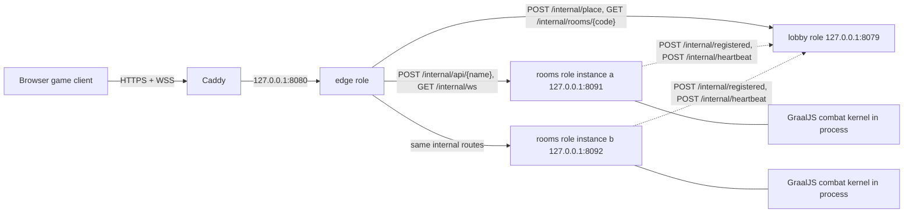

# Backend services

The Scala backend runs as three roles — `edge`, `lobby` and `rooms` — from one
release artifact. Production starts each role as its own systemd unit; the local
launcher (`npm run lan`) starts the same three roles as three JVMs on loopback.
`SERVICE_ROLE` selects the role at startup, and the packaged `bin/mygo-server`
entry point is unchanged.

This split was adopted on 2026-10-29 for separate public admission, directory
and room-execution scaling. The authoritative combat tick loop deliberately
stays inside one process; see [Latency budget and the tick loop](#latency-budget-and-the-tick-loop).

## Topology



Only the edge listens on a public-facing address. Caddy still forwards HTTPS and
WSS to `127.0.0.1:8080`, so the public proxy configuration is unchanged. Every
edge/lobby/rooms call is loopback HTTP and must present the shared
`INTERNAL_SECRET` when one is configured. Rooms instances send registrations and
heartbeats to the lobby but never call the edge. The edge never owns room state.

## Role responsibilities

| Role     | Listener                                      | Owns                                                                                                                                               | Does not do                                            |
| -------- | --------------------------------------------- | -------------------------------------------------------------------------------------------------------------------------------------------------- | ------------------------------------------------------ |
| `edge`   | public `HOST:PORT`                            | Static files, `/api/health`, per-client admission counters, same-origin checks, forwarding of public API messages, WebSocket proxying, owner cache | Room state, sessions, placement, combat simulation     |
| `lobby`  | internal `LOBBY_HOST:LOBBY_PORT`              | Global room budget, instance registry from heartbeats, room-code directory, placement/reservations, global `MAX_ROOMS`                             | Player sockets, room messages, combat, snapshots       |
| `rooms`  | internal `ROOMS_HOST:ROOMS_PORT` per instance | Room lifecycle, sessions, membership, selection/readiness/lifecycle, the combat kernel, the 120 Hz tick loop, snapshots, per-instance `MAX_ROOMS`  | Public HTTP, WebSockets, placement, global room budget |
| `system` | none                                          | Role dispatch (`Main`), static serving, `OriginCheck`/`InternalGuard`, cross-process payload types under `objects/internal/`                       | Room messages, room API registration, business state   |

`services/system/objects/internal/` is the single home for payload types shared
across processes: `PlacementResult`, `RoomOwnerResult`, `RegisteredRoom`,
`InstanceSummary`, `RoomSummary` and `InternalError`. Internal endpoints are
guarded by `services/system/routes/InternalGuard`, so a caller must arrive over
loopback and, when `INTERNAL_SECRET` is set, present
`X-Mygo-Internal: <secret>`.

## Release and role selection

`backend/build.sbt` packages one `mygo-server-2.0.0.tgz` containing every role.
At startup `services/system/api/Main.scala` reads `SERVICE_ROLE`:

| Value           | Behavior                                                                                                                            |
| --------------- | ----------------------------------------------------------------------------------------------------------------------------------- |
| `edge`          | Starts only the public edge role.                                                                                                   |
| `lobby`         | Starts only the internal lobby role.                                                                                                |
| `rooms`         | Starts one internal rooms instance; `INSTANCE_ID`, `INSTANCE_URL` and the port identify it.                                         |
| `all` (default) | Composes lobby, rooms and edge in one JVM behind loopback. Intended for local debugging and latency comparison, not for deployment. |
| anything else   | Startup fails with `Unsupported SERVICE_ROLE: ...`.                                                                                 |

The deployed units are `mygo-edge.service`, `mygo-lobby.service` and the
instance template `mygo-rooms@.service` (`%i` is the rooms instance ID). See
[Deployment and rollback](#deployment-and-rollback).

## Internal service contract

All paths below are prefixed with `/internal` and are reachable only over
loopback. When `INTERNAL_SECRET` is configured, a request without a matching
`X-Mygo-Internal` header is rejected with `403` and
`{"error":"内部接口不允许外部访问"}`.

| Endpoint                     | Caller → callee                               | Request body                                                                 | Success                 | Failure                                                                       |
| ---------------------------- | --------------------------------------------- | ---------------------------------------------------------------------------- | ----------------------- | ----------------------------------------------------------------------------- |
| `POST /internal/place`       | edge → lobby                                  | `{}` (body ignored)                                                          | `200` `PlacementResult` | `503` `InternalError` room-full message; edge maps transport failure to `502` |
| `GET /internal/rooms/{code}` | edge → lobby                                  | none; `code` path segment normalized to uppercase                            | `200` `RoomOwnerResult` | `404` `InternalError` missing-room message                                    |
| `POST /internal/registered`  | rooms → lobby                                 | `RegisteredRoom`                                                             | `204`                   | Rooms treats the call as best effort and ignores the result                   |
| `POST /internal/heartbeat`   | rooms → lobby                                 | `InstanceSummary` (instance identity, capacity and current rooms)            | `204`                   | Rooms treats the call as best effort and ignores the result                   |
| `POST /internal/api/{name}`  | edge → rooms                                  | Public JSON body unchanged; `createroom` is rewritten to `{"code":"ABC123"}` | `200` public response   | `400` invalid request, `404` unknown name, `429` with `Retry-After` preserved |
| `GET /internal/ws?room=CODE` | edge → rooms                                  | WebSocket upgrade; the room code query is the owner routing key              | `101` upgrade           | Missing room/owner closes with an error frame; room mismatch is rejected      |
| `GET /internal/health`       | edge → lobby/rooms, activate/rollback → roles | none                                                                         | `200` role health JSON  | Non-200 or timeout marks the dependency unavailable                           |

Payload bodies:

| Type              | JSON                                                                                                            |
| ----------------- | --------------------------------------------------------------------------------------------------------------- |
| `PlacementResult` | `{"instanceId":"a","instanceUrl":"http://127.0.0.1:8091","code":"A1B2C3"}`                                      |
| `RoomOwnerResult` | `{"instanceId":"a","instanceUrl":"http://127.0.0.1:8091"}`                                                      |
| `RegisteredRoom`  | `{"code":"A1B2C3","instanceId":"a"}`                                                                            |
| `InstanceSummary` | `{"instanceId":"a","instanceUrl":"http://127.0.0.1:8091","capacity":4,"rooms":[{"code":"A1B2C3","players":2}]}` |
| `InternalError`   | `{"error":"..."}`                                                                                               |

Role health bodies:

| Role    | Body                                                                                                                  |
| ------- | --------------------------------------------------------------------------------------------------------------------- |
| `lobby` | `{"role":"lobby","ok":true,"instances":1,"rooms":1}`                                                                  |
| `rooms` | `{"role":"rooms","instanceId":"a","rooms":1,"ok":true}`                                                               |
| `edge`  | `{"app":"mygo-scala","ok":true,"tickHz":120,"snapshotHz":60,"services":{"edge":"ok","lobby":"ok","rooms":"unknown"}}` |

The edge health body reports each dependency as `ok`, `down`, `unknown` or
`disabled`, depending on configuration and probe results. It probes `LOBBY_URL`
and, when configured, `ROOMS_DIRECT_URL` with a short timeout; a deployment that
routes every room through the lobby normally reports `rooms` as `unknown`. That
does not fail the endpoint. Activation scripts check the internal health bodies
for `"ok":true` and the public edge body for `"app":"mygo-scala"`.

Placement and directory behavior:

- The lobby serializes placement through one permit, so concurrent creates see
  the same budget snapshot. A room is placed only when the directory plus live
  reservations stays below the global `MAX_ROOMS`, and the chosen instance's
  reported rooms plus reservations stays below
  `min(ROOMS_PER_INSTANCE, capacity)`.
- The least-loaded live instance wins; ties break by `instanceId`. A live
  instance is one whose last heartbeat is younger than `INSTANCE_TTL_MS`.
- Codes are three secure random bytes rendered as six uppercase hexadecimal
  characters (`ABC123`), retried up to five times against the directory and
  reservations.
- A placement creates a short reservation (`RESERVATION_TTL_MS`) that bridges
  the gap until the rooms instance reports the new room. Owner lookup accepts a
  live reservation, so the host's first follow-up request can succeed before the
  next heartbeat.
- Heartbeats rebuild the code-to-instance directory and clear reservations that
  the reporting instance has confirmed. A one-second lobby loop drops stale
  instances, their directory entries and expired reservations.

Rooms side:

- A rooms instance reports itself and its current rooms to the lobby every
  `HEARTBEAT_INTERVAL_MS` (default 2000 ms). `LobbyClient` uses short internal
  timeouts and swallows failures: room creation and combat must keep working
  when the lobby is unavailable.
- `CreateRoomMessage` accepts an optional six-hex code from the edge placement,
  otherwise the instance generates its own code. The instance enforces its own
  `MAX_ROOMS` and reports the shared room-full message.
- The internal API router applies the same registrations and body limit as the
  public protocol; the edge is a transparent transport for room messages.

## Public API routing

Caddy terminates TLS, then the edge handles every public request:

| Request                | Edge behavior                                                                                                                                                                                                                    | Answered or forwarded by |
| ---------------------- | -------------------------------------------------------------------------------------------------------------------------------------------------------------------------------------------------------------------------------- | ------------------------ |
| `GET /api/health`      | Local health; probes `LOBBY_URL` and, when configured, `ROOMS_DIRECT_URL` with short timeouts                                                                                                                                    | edge                     |
| `POST /api/createroom` | Admitted at 20 requests per client per minute. Asks the lobby to place a code, then forwards the request to the owning rooms instance with `{"code":...}`; retries once on a transient placement or forward reply (HTTP 400/503) | lobby, then rooms        |
| `POST /api/joinroom`   | Admitted at 20/min. Reads `code` from the body, resolves the owning instance from the 3 s owner cache or the lobby, then forwards the body unchanged                                                                             | lobby, then rooms        |
| `POST /api/{name}`     | For the other registered room messages: reads the six-hex code from the token prefix (`ABC123.<48 hex>`), resolves the owner, forwards the body unchanged                                                                        | lobby, then rooms        |
| `GET /ws?room=CODE`    | Admitted at 60 handshakes per client per minute. Same-origin check, owner lookup, then a bidirectional WebSocket proxy to the owning rooms instance                                                                              | lobby, then rooms        |
| `GET /*` (other paths) | Static file from `WEB_ROOT`; `media/` and `assets/` are immutable for one year, everything else is `no-cache`; `api/` and `ws` are never served as files                                                                         | edge                     |

Registered room messages and their public endpoints:

| Message type         | `POST /api/...` | Identity                                                   |
| -------------------- | --------------- | ---------------------------------------------------------- |
| `CreateRoomMessage`  | `createroom`    | None; creates a host session.                              |
| `JoinRoomMessage`    | `joinroom`      | None; joins by six-hex room code and creates a session.    |
| `ChooseRoomMessage`  | `chooseroom`    | Trusted session token; host controls shared room settings. |
| `ReadyRoomMessage`   | `readyroom`     | Trusted session token.                                     |
| `LoadedRoomMessage`  | `loadedroom`    | Trusted session token, generation and attached peer.       |
| `PauseRoomMessage`   | `pauseroom`     | Trusted session token.                                     |
| `RestartRoomMessage` | `restartroom`   | Trusted session token; host only.                          |
| `FinishRoomMessage`  | `finishroom`    | Trusted session token and presentation tick.               |
| `LobbyRoomMessage`   | `lobbyroom`     | Trusted session token.                                     |
| `LeaveRoomMessage`   | `leaveroom`     | Trusted session token; revokes the session.                |

`AttachRoomMessage`, `SubmitInputMessage`, `DisconnectRoomMessage` and
`ResolveSessionMessage` remain internal to the rooms process and the socket
boundary; they have no public HTTP endpoint and no frontend caller file.

Edge failure mapping and limits:

- Unknown room: `joinroom` returns `400` with the missing-room message; other
  messages return `400` with the expired-room message.
- The owner cache is bounded (4096 codes) and expires after
  `ROOM_CACHE_TTL_MS`; a sweep runs every 5 s.
- Transport failure to lobby or rooms maps to `502`; an internal timeout maps to
  `504`. Other upstream replies, including the room-full `503` and a `429` with
  `Retry-After`, pass through with their status and body. A rejected socket
  handshake with no valid `room` query returns `400` with `缺少房间码`.
- Public API requests are limited to 8 KiB; a larger body is rejected before it
  reaches the owning service. Same-origin browser requests are enforced
  (`Origin` authority must equal `Host`).
- Admission counters are per client address (or the last `X-Forwarded-For`
  address from a loopback proxy when `TRUST_LOCAL_PROXY=true`), expire after one
  minute and are capped at 4096 address/category entries. Rejection is `429` with
  `Retry-After: 60` and the Chinese retry message.
- With no `LOBBY_URL`, the edge forwards room creation and every owner lookup to
  `ROOMS_DIRECT_URL`; the rooms instance then generates its own room code. This
  fallback is for a single-instance debugging layout, not the deployed
  topology.

## Room codes, tokens and protocol 25

- The WebSocket handshake protocol is **25**. The server rejects any other
  version with `客户端与主机版本不一致，请房主重启联机服务，双方刷新页面。`
- A room token is `<six uppercase hex code>.<48 hex characters>`, for example
  `A1B2C3.` followed by 48 hex digits. The code identifies the owning instance;
  the 48-hex suffix is 24 random bytes of session secret.
- The client receives the token in `SessionResponse` (`token`, `side`, `room`)
  and keeps it in tab-scoped session storage. Authenticated HTTP messages and
  the socket `authenticate` message carry the token; the token never appears in
  a URL.
- The WebSocket URL carries only the shareable room code:
  `GET /ws?room=CODE`. The socket must then authenticate with the token and the
  same protocol version; if the query code does not match the token's room, the
  server returns the expired-room message.
- The edge needs the room code before it can forward anything, so the code is
  exported twice: as the token prefix for HTTP messages and as the `?room=` query
  for the socket. This is why protocol 24 and earlier clients are incompatible:
  their tokens lacked the code prefix and their sockets connected to `/ws`
  without a room query.
- Room codes are not secrets — players share them to join. Tokens are
  credentials: they are validated into a trusted session at the router boundary
  before any room command runs.
- Existing clients must refresh after deployment. A server restart also ends all
  temporary rooms, as before.

## Configuration matrix

Every role reads environment variables. Deployment adds the shared
`SERVICE_ROLE=...` in the unit and the values below in
`/etc/mygo-fighter/{base,edge,lobby,rooms}.env` and optional per-instance
`rooms-<id>.env`. The local launcher builds the same variables directly.

| Variable                  | Role         | Default                          | Rules and meaning                                                                                                            |
| ------------------------- | ------------ | -------------------------------- | ---------------------------------------------------------------------------------------------------------------------------- |
| `SERVICE_ROLE`            | all          | `all`                            | `edge`, `lobby`, `rooms` or `all`; other values fail startup.                                                                |
| `INTERNAL_SECRET`         | all          | unset                            | Shared internal-call secret. When set, all edge/lobby/rooms internal HTTP calls must present it. The installer generates it. |
| `HOST`                    | edge         | `127.0.0.1`                      | Public bind address. LAN launcher uses `0.0.0.0`.                                                                            |
| `PORT`                    | edge         | `8080`                           | Public port, 1–65535.                                                                                                        |
| `WEB_ROOT`                | edge         | `../frontend/dist`               | Static file root; packaged deployments use `/srv/mygo-fighter/current/web`.                                                  |
| `LOBBY_URL`               | edge, rooms  | unset                            | Lobby base URL for placement/owner lookup (edge) and heartbeats (rooms).                                                     |
| `ROOMS_DIRECT_URL`        | edge         | unset                            | Direct rooms URL used only when no lobby is configured.                                                                      |
| `TRUST_LOCAL_PROXY`       | edge         | `false`                          | `true` only behind a loopback proxy; accepts the last `X-Forwarded-For` address.                                             |
| `ROOM_CACHE_TTL_MS`       | edge         | `3000`                           | Room-owner cache entry lifetime; at least 250.                                                                               |
| `OWNER_LOOKUP_TIMEOUT_MS` | edge         | `300`                            | Lobby owner lookup timeout; at least 50.                                                                                     |
| `FORWARD_TIMEOUT_MS`      | edge         | `10000`                          | Forwarding timeout to a rooms instance; at least 1000.                                                                       |
| `WS_QUEUE_FRAMES`         | edge         | `64`                             | Bounded per-connection proxy queue; at least 8.                                                                              |
| `LOBBY_HOST`              | lobby        | `127.0.0.1`                      | Lobby bind address; internal only.                                                                                           |
| `LOBBY_PORT`              | lobby        | `8079`                           | Lobby port, 1–65535.                                                                                                         |
| `MAX_ROOMS`               | lobby, rooms | `4`                              | Lobby: global ceiling. Rooms: this instance's ceiling. Positive.                                                             |
| `ROOMS_PER_INSTANCE`      | lobby        | equals `MAX_ROOMS`               | Placement ceiling per instance; positive and no larger than `MAX_ROOMS`.                                                     |
| `INSTANCE_TTL_MS`         | lobby        | `6000`                           | Heartbeat age after which an instance is dropped; at least 2000.                                                             |
| `RESERVATION_TTL_MS`      | lobby        | `10000`                          | Placement reservation lifetime; at least 2000.                                                                               |
| `ROOMS_HOST`              | rooms        | `127.0.0.1`                      | Rooms bind address; internal only.                                                                                           |
| `ROOMS_PORT`              | rooms        | `8091`                           | Rooms port, 1–65535; instance a uses 8091, instance b 8092.                                                                  |
| `INSTANCE_ID`             | rooms        | `a`                              | Lowercase letters, digits and dashes; provided by the template instance.                                                     |
| `INSTANCE_URL`            | rooms        | `http://$ROOMS_HOST:$ROOMS_PORT` | URL reported to the lobby and used by the edge to forward.                                                                   |
| `HEARTBEAT_INTERVAL_MS`   | rooms        | `2000`                           | Registration/heartbeat period; at least 250.                                                                                 |

Deployed unit limits:

| Role    | Unit                  | `JAVA_OPTS`                                                                                  | MemoryMax | Cache                              |
| ------- | --------------------- | -------------------------------------------------------------------------------------------- | --------- | ---------------------------------- |
| `edge`  | `mygo-edge.service`   | `-Xms16m -Xmx80m -XX:ReservedCodeCacheSize=32m -Xss512k`                                     | 192M      | none                               |
| `lobby` | `mygo-lobby.service`  | `-Xms16m -Xmx48m -XX:ReservedCodeCacheSize=24m -Xss512k`                                     | 128M      | none                               |
| `rooms` | `mygo-rooms@.service` | `-Xms64m -Xmx256m -XX:ReservedCodeCacheSize=64m -Dpolyglot.engine.WarnInterpreterOnly=false` | 512M      | `/var/cache/mygo-fighter/rooms-%i` |

These ceilings are the initial budget on a two-vCPU, approximately 1.6 GiB host;
they are configuration, not measured capacity. Confirm them with
`systemctl show` and the deployment checks before raising `MAX_ROOMS`.

## Failure modes and graceful degradation

| Failure                                  | Effect                                                                                                                                                                                                                      | Recovery                                                                                           |
| ---------------------------------------- | --------------------------------------------------------------------------------------------------------------------------------------------------------------------------------------------------------------------------- | -------------------------------------------------------------------------------------------------- |
| Lobby unavailable                        | New room creation cannot be placed, so the edge reports `502`; existing rooms keep running and commands already routed by cached ownership can still work for up to the cache TTL. Rooms heartbeats are dropped harmlessly. | Restart the lobby; instances re-register within one heartbeat interval and the directory rebuilds. |
| Rooms instance unavailable               | Its rooms are lost (temporary state). The lobby drops the instance after `INSTANCE_TTL_MS`; the edge may serve an error from a stale cached owner until the cache entry expires.                                            | Restart the instance; it re-registers itself. Capacity returns for new rooms.                      |
| Edge unavailable                         | The public site and API are unreachable, but lobby and rooms keep their state and idle rooms keep ticking.                                                                                                                  | Restart the edge; clients reconnect with their stored sessions.                                    |
| Everything restarted                     | All temporary rooms and sessions are discarded, as before.                                                                                                                                                                  | Clients create or join rooms again.                                                                |
| `INTERNAL_SECRET` missing                | Internal endpoints remain loopback-only, but no shared header is required.                                                                                                                                                  | Installer-generated secret; set it and restart the roles.                                          |
| Internal secret mismatch                 | All cross-process calls are rejected with `403`; start fails health checks.                                                                                                                                                 | Use one `/etc/mygo-fighter/base.env` for every unit.                                               |
| Global room budget reached               | Lobby returns the room-full message; public creation is reported as server full.                                                                                                                                            | Free or expire rooms, or raise `MAX_ROOMS` deliberately.                                           |
| Per-instance room budget reached         | The rooms instance rejects creation with the room-full message.                                                                                                                                                             | Join an existing room or place on another live instance.                                           |
| Admission limit reached                  | `429` with `Retry-After: 60` for create/join or socket handshakes from that client address.                                                                                                                                 | Wait for the one-minute window.                                                                    |
| Combat kernel crash inside one rooms JVM | The unit restarts; that instance's rooms are lost and it re-registers with the lobby.                                                                                                                                       | Clients reconnect and create or join again.                                                        |

The lobby holds no durable state: `mygo-lobby` can be restarted at any time and
rebuilds its directory from room heartbeats. The edge holds only bounded caches
and admission counters. The rooms process is the only owner of live room state.

## Latency budget and the tick loop

Responses that cross process boundaries are limited to the request path:

- Room creation adds one lobby placement call (500 ms internal timeout) plus one
  forward to the rooms instance (`FORWARD_TIMEOUT_MS`, default 10 s).
- Join and other room messages add at most one owner lookup: memory cache first,
  otherwise a lobby call with `OWNER_LOOKUP_TIMEOUT_MS` (default 300 ms). A
  successful lookup is cached for `ROOM_CACHE_TTL_MS` (default 3 s).
- Socket traffic is proxied as WebSocket frames without re-serialization through
  a bounded queue (`WS_QUEUE_FRAMES`, default 64). A full queue closes the
  proxied connection instead of buffering without limit.
- These are bounded failure budgets, not expected network latency. Internal
  calls are loopback HTTP; no internal call appears on the combat clock path.

The authoritative tick loop stays inside one rooms process:

- The kernel advances in fixed 10 ms steps on a 120 Hz room loop (8.33 ms per
  iteration) and targets 60 active snapshots per second. Each room is guarded by
  one semaphore so commands and simulation never enter the same room's GraalJS
  context concurrently. The per-room context is process-local and cannot be
  shared across JVMs.
- Splitting the tick loop across processes would add a synchronous internal round
  trip and state serialization to every iteration, or require state replication
  and cross-process locking. That work would consume a meaningful share of the
  8.33 ms deadline and would make room authority ambiguous; the existing design
  already keeps separate rooms advancing independently without a global batch.
- Therefore the rooms tick path must never make cross-process calls. Room
  registration and heartbeats are background fibers with short timeouts; they are
  best-effort and never block a tick. Cross-process payload types live under
  `services/system/objects/internal/`, and `AGENTS.md` records the rule.
- The [2026-10-27 scaling record](BACKEND_SCALING_2026-10-27.md) measured a
  same-machine, eight-room loopback workload: battle server-update p95 1.74 ms,
  snapshot arrival gap p95 29.37 ms and input send-to-receipt p95 29.16 ms after
  the scheduling changes. Those numbers describe that workstation run and are not
  host capacity or Internet-latency guarantees. The room loop cadence, idle
  intervals, snapshot policy and catch-up cap are described in
  [LAN protocol and performance](LAN.md).

## Deployment and rollback

The release artifact is `backend/target/universal/mygo-server-2.0.0.tgz` from
`npm run package:server`. Deploy files live in `deploy/`:

| File                           | Purpose                                                                   |
| ------------------------------ | ------------------------------------------------------------------------- |
| `deploy/mygo-edge.service`     | Public edge unit.                                                         |
| `deploy/mygo-lobby.service`    | Internal lobby unit.                                                      |
| `deploy/mygo-rooms@.service`   | Rooms template unit; the instance ID is `%i`.                             |
| `deploy/env/base.env.example`  | Shared `INTERNAL_SECRET` and `ROOMS_INSTANCES`.                           |
| `deploy/env/edge.env.example`  | Public edge settings.                                                     |
| `deploy/env/lobby.env.example` | Global room budget and directory settings.                                |
| `deploy/env/rooms.env.example` | Per-instance rooms settings; per-instance overrides use `rooms-<id>.env`. |
| `deploy/server.env.example`    | Legacy single-unit settings, kept with a migration note.                  |
| `deploy/install.sh`            | First-time host install: units, env files, secret, Caddy.                 |
| `deploy/activate.sh`           | Whole-set release activation with health checks and rollback.             |
| `deploy/rollback.sh`           | Whole-set rollback to the retained previous release.                      |
| `deploy/Caddyfile`             | Unchanged reverse proxy to `127.0.0.1:8080`.                              |

First install, run as root with the public hostname:

```sh
sudo bash deploy/install.sh PUBLIC_HOSTNAME
```

The installer creates the `mygo` account and `/srv/mygo-fighter/releases`,
installs the three units and the hosting scripts under `/opt/mygo-fighter`,
creates `/etc/mygo-fighter/{base,edge,lobby,rooms}.env` only when they are
missing, appends a generated 64-hex `INTERNAL_SECRET` when none exists, and
enables `caddy`, `mygo-edge`, `mygo-lobby` and `mygo-rooms@<id>` for every
instance in `ROOMS_INSTANCES`. It keeps the existing Caddy safety behaviour and
is idempotent. On a host that still has the old `mygo-fighter.service`, it
disables and stops that unit so both layouts cannot fight over port 8080, and
prints migration steps; `/etc/mygo-fighter.env` is preserved but no longer read.

Activation extracts the release, verifies `bin/mygo-server` and
`web/index.html`, then replaces the whole role set:

```sh
sudo bash /opt/mygo-fighter/activate.sh ARCHIVE RELEASE_ID [COMMIT]
```

1. Serializes with the host-local deployment lock.
2. Stops `mygo-edge`, then `mygo-lobby`, then every `mygo-rooms@<id>` instance.
3. Atomically switches `/srv/mygo-fighter/current` to the new release.
4. Starts every rooms instance, then the lobby, then the edge.
5. Waits for each rooms and lobby `/internal/health` to report `"ok":true` and
   for `edge /api/health` to report `"app":"mygo-scala"`.
6. Writes `deployment.json` in the active release: release ID, optional commit,
   archive SHA-256, activation time, role hosts and ports, and the rooms
   instance list.
7. Keeps the replaced release in `/srv/mygo-fighter/previous`.

A failed switch, start or health check restores the previous release and
restarts the full set. `sudo bash /opt/mygo-fighter/rollback.sh` reverses the
active and previous links with the same stop, start and health-check sequence and
restores the active release if the rollback itself fails. Deployment and rollback
both stop the roles, so a release switch ends temporary rooms and both players
must refresh.

The Caddy reverse proxy remains `https://PUBLIC_HOSTNAME` → `127.0.0.1:8080`;
only the edge listens on that port. See [public online hosting](WAN.md) for host
provisioning, port rules and operations commands.

## Local three-process topology

`npm run lan` is unchanged as a command. The launcher builds the frontend and
stages the same JVM artifact, then starts three role processes on loopback:

| Process | Role    | Port | Key environment                                                  |
| ------- | ------- | ---- | ---------------------------------------------------------------- |
| 1       | `rooms` | 8091 | `ROOMS_PORT=8091`, `INSTANCE_ID=a`, `MAX_ROOMS=PUBLIC MAX_ROOMS` |
| 2       | `lobby` | 8079 | `LOBBY_PORT=8079`, global `MAX_ROOMS`, `ROOMS_PER_INSTANCE`      |
| 3       | `edge`  | 8080 | `HOST` (default `0.0.0.0`), `PORT`, `WEB_ROOT`, `LOBBY_URL`      |

`MAX_ROOMS` defaults to 20 for LAN play. `INTERNAL_SECRET`, `TRUST_LOCAL_PROXY`,
`HEARTBEAT_INTERVAL_MS` and `INSTANCE_TTL_MS` are forwarded when set. The
launcher still probes `/api/health` for `"app":"mygo-scala"`, prints the same
playable addresses and stops all three processes together; `stop-lan.cmd` (or
closing the launcher window) ends the whole set. A single-JVM debugging layout
remains available by starting the packaged entry point without `SERVICE_ROLE`
(the `all` mode), but the LAN launcher does not use it.

Source map for the split:

| Path                                                                | Contents                                                                             |
| ------------------------------------------------------------------- | ------------------------------------------------------------------------------------ |
| `backend/src/main/scala/services/system/api/Main.scala`             | `SERVICE_ROLE` dispatch and the `all` composition                                    |
| `backend/src/main/scala/services/edge/`                             | Admission, owner cache, instance client, edge routes                                 |
| `backend/src/main/scala/services/lobby/`                            | Registry, placement, internal routes, lobby process                                  |
| `backend/src/main/scala/services/rooms/`                            | Room messages, message router/registration, runtime, socket, internal routes, kernel |
| `backend/src/main/scala/services/system/objects/internal/`          | Cross-process payload types                                                          |
| `backend/src/main/scala/services/system/routes/InternalGuard.scala` | Loopback/secret guard for internal endpoints                                         |
| `backend/src/main/scala/services/system/routes/OriginCheck.scala`   | Same-origin check shared by edge and rooms routes                                    |

The public game protocol, combat rules and player-visible behavior are otherwise
unchanged by the split. See [architecture and review guide](ARCHITECTURE.md) and
[LAN protocol and timing](LAN.md) for the frontend and combat details.
