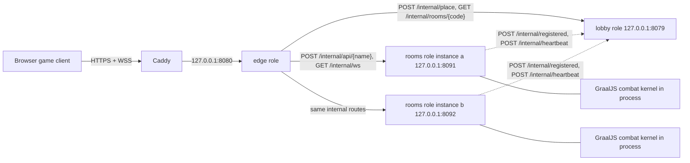

**简体中文** | [English](SERVICES.en.md) | [日本語](SERVICES.ja.md)

# 后端服务

Scala 后端以一个发布产物中的三个角色——`edge`、`lobby` 与 `rooms`——运行。生产环境把每个角色作为独立的 systemd 单元启动；本地启动器（`npm run lan`）在回环地址上把同样的三个角色作为三个 JVM 启动。`SERVICE_ROLE` 在启动时选择角色，打包后的 `bin/mygo-server` 入口保持不变。

这次拆分于 2026-10-29 采用，目的是让公网准入、目录与房间执行能够分别伸缩。权威战斗 tick 循环有意保留在单个进程内；见[延迟预算与 tick 循环](#延迟预算与-tick-循环)。

## 拓扑



只有 edge 监听面向公网的地址。Caddy 仍把 HTTPS 与 WSS 转发到 `127.0.0.1:8080`，因此公网代理配置不变。每次 edge/lobby/rooms 调用都是回环 HTTP，在配置了共享的 `INTERNAL_SECRET` 时必须携带它。rooms 实例向 lobby 发送注册与心跳，但从不调用 edge。edge 从不持有房间状态。

## 角色职责

| 角色     | 监听地址                               | 负责                                                                                                    | 不负责                                   |
| -------- | -------------------------------------- | ------------------------------------------------------------------------------------------------------- | ---------------------------------------- |
| `edge`   | 公网 `HOST:PORT`                       | 静态文件、`/api/health`、逐客户端准入计数、同源检查、公网 API 消息转发、WebSocket 代理、owner 缓存      | 房间状态、会话、放置、战斗模拟           |
| `lobby`  | 内部 `LOBBY_HOST:LOBBY_PORT`           | 全局房间预算、由心跳构建的实例注册表、房间码目录、放置/预留、全局 `MAX_ROOMS`                           | 玩家 socket、房间消息、战斗、快照        |
| `rooms`  | 每个实例的内部 `ROOMS_HOST:ROOMS_PORT` | 房间生命周期、会话、成员关系、选择/准备/生命周期、战斗内核、120 Hz tick 循环、快照、每实例 `MAX_ROOMS`  | 公网 HTTP、WebSocket、放置、全局房间预算 |
| `system` | 无                                     | 角色分发（`Main`）、静态文件服务、`OriginCheck`/`InternalGuard`、`objects/internal/` 下的跨进程负载类型 | 房间消息、房间 API 注册、业务状态        |

`services/system/objects/internal/` 是跨进程共享负载类型的唯一归属地：`PlacementResult`、`RoomOwnerResult`、`RegisteredRoom`、`InstanceSummary`、`RoomSummary` 与 `InternalError`。内部端点由 `services/system/routes/InternalGuard` 守卫，因此调用方必须经由回环到达，并且在设置了 `INTERNAL_SECRET` 时出示 `X-Mygo-Internal: <secret>`。

## 发布与角色选择

`backend/build.sbt` 打包一个包含所有角色的 `mygo-server-2.0.0.tgz`。启动时 `services/system/api/Main.scala` 读取 `SERVICE_ROLE`：

| 取值          | 行为                                                                                     |
| ------------- | ---------------------------------------------------------------------------------------- |
| `edge`        | 只启动公网 edge 角色。                                                                   |
| `lobby`       | 只启动内部 lobby 角色。                                                                  |
| `rooms`       | 启动一个内部 rooms 实例；由 `INSTANCE_ID`、`INSTANCE_URL` 与端口标识它。                 |
| `all`（默认） | 在同一个 JVM 中于回环后面组合 lobby、rooms 与 edge。用于本地调试与延迟对比，不用于部署。 |
| 其他任意值    | 启动失败，并报 `Unsupported SERVICE_ROLE: ...`。                                         |

部署单元为 `mygo-edge.service`、`mygo-lobby.service` 与实例模板 `mygo-rooms@.service`（`%i` 是 rooms 实例 ID）。见[部署与回滚](#部署与回滚)。

## 内部服务契约

下面所有路径都以 `/internal` 为前缀，且只能通过回环访问。配置了 `INTERNAL_SECRET` 时，缺少匹配 `X-Mygo-Internal` 头的请求会以 `403` 与 `{"error":"内部接口不允许外部访问"}` 被拒绝。

| 端点                         | 调用方 → 被调用方                              | 请求体                                                          | 成功                    | 失败                                                            |
| ---------------------------- | ---------------------------------------------- | --------------------------------------------------------------- | ----------------------- | --------------------------------------------------------------- |
| `POST /internal/place`       | edge → lobby                                   | `{}`（请求体被忽略）                                            | `200` `PlacementResult` | `503` `InternalError` 房间已满消息；edge 把传输失败映射为 `502` |
| `GET /internal/rooms/{code}` | edge → lobby                                   | 无；`code` 路径段会被规范化为大写                               | `200` `RoomOwnerResult` | `404` `InternalError` 房间不存在消息                            |
| `POST /internal/registered`  | rooms → lobby                                  | `RegisteredRoom`                                                | `204`                   | rooms 把该调用视为尽力而为并忽略结果                            |
| `POST /internal/heartbeat`   | rooms → lobby                                  | `InstanceSummary`（实例身份、容量与当前房间）                   | `204`                   | rooms 把该调用视为尽力而为并忽略结果                            |
| `POST /internal/api/{name}`  | edge → rooms                                   | 公网 JSON 请求体不变；`createroom` 被重写为 `{"code":"ABC123"}` | `200` 公网响应          | `400` 无效请求、`404` 未知名称、`429` 并保留 `Retry-After`      |
| `GET /internal/ws?room=CODE` | edge → rooms                                   | WebSocket 升级；房间码查询参数是 owner 路由键                   | `101` 升级              | 缺少房间/owner 时以错误帧关闭；房间不匹配会被拒绝               |
| `GET /internal/health`       | edge → lobby/rooms，activate/rollback → 各角色 | 无                                                              | `200` 角色健康 JSON     | 非 200 或超时会把该依赖标记为不可用                             |

负载体：

| 类型              | JSON                                                                                                            |
| ----------------- | --------------------------------------------------------------------------------------------------------------- |
| `PlacementResult` | `{"instanceId":"a","instanceUrl":"http://127.0.0.1:8091","code":"A1B2C3"}`                                      |
| `RoomOwnerResult` | `{"instanceId":"a","instanceUrl":"http://127.0.0.1:8091"}`                                                      |
| `RegisteredRoom`  | `{"code":"A1B2C3","instanceId":"a"}`                                                                            |
| `InstanceSummary` | `{"instanceId":"a","instanceUrl":"http://127.0.0.1:8091","capacity":4,"rooms":[{"code":"A1B2C3","players":2}]}` |
| `InternalError`   | `{"error":"..."}`                                                                                               |

角色健康响应体：

| 角色    | 响应体                                                                                                                |
| ------- | --------------------------------------------------------------------------------------------------------------------- |
| `lobby` | `{"role":"lobby","ok":true,"instances":1,"rooms":1}`                                                                  |
| `rooms` | `{"role":"rooms","instanceId":"a","rooms":1,"ok":true}`                                                               |
| `edge`  | `{"app":"mygo-scala","ok":true,"tickHz":120,"snapshotHz":60,"services":{"edge":"ok","lobby":"ok","rooms":"unknown"}}` |

edge 的健康响应体会把每个依赖报告为 `ok`、`down`、`unknown` 或 `disabled`，取决于配置与探测结果。它会以较短的超时探测 `LOBBY_URL`，以及在配置时探测 `ROOMS_DIRECT_URL`；把所有房间都经 lobby 路由的部署通常把 `rooms` 报告为 `unknown`。这不会使该端点失败。激活脚本检查内部健康响应体中的 `"ok":true`，以及公网 edge 响应体中的 `"app":"mygo-scala"`。

放置与目录行为：

- lobby 通过单个许可串行化放置，因此并发的创建请求看到的是同一份预算快照。只有当目录加上实时预留仍低于全局 `MAX_ROOMS`，且所选实例上报的房间数加上预留仍低于 `min(ROOMS_PER_INSTANCE, capacity)` 时，才会放置房间。
- 负载最低的存活实例胜出；平局按 `instanceId` 决胜。存活实例是指其最后一次心跳早于 `INSTANCE_TTL_MS` 的实例。
- 房间码是三个安全随机字节，渲染为六位大写十六进制字符（`ABC123`），并针对目录与预留最多重试五次。
- 一次放置会创建一条短期预留（`RESERVATION_TTL_MS`），填补直到 rooms 实例上报新房间之前的空档。owner 查询接受存活的预留，因此房主的第一次后续请求可以在下一次心跳之前就成功。
- 心跳会重建房间码到实例的目录，并清除上报实例已确认的预留。lobby 中每秒运行一次的循环会丢弃过期实例、它们的目录条目以及已过期的预留。

rooms 一侧：

- rooms 实例每隔 `HEARTBEAT_INTERVAL_MS`（默认 2000 ms）向 lobby 上报自身及其当前房间。`LobbyClient` 使用较短的内部超时并吞掉失败：当 lobby 不可用时，房间创建与战斗必须照常工作。
- `CreateRoomMessage` 接受来自 edge 放置的可选六位十六进制房间码，否则由实例自行生成房间码。实例执行自己的 `MAX_ROOMS` 并上报共享的房间已满消息。
- 内部 API 路由使用与公网协议相同的注册表与请求体上限；edge 对房间消息而言是透明的传输层。

## 公网 API 路由

Caddy 终止 TLS，然后由 edge 处理每个公网请求：

| 请求                   | edge 行为                                                                                                                                                        | 由谁应答或转发    |
| ---------------------- | ---------------------------------------------------------------------------------------------------------------------------------------------------------------- | ----------------- |
| `GET /api/health`      | 本地健康检查；以较短的超时探测 `LOBBY_URL`，以及在配置时探测 `ROOMS_DIRECT_URL`                                                                                  | edge              |
| `POST /api/createroom` | 每客户端每分钟准入 20 次请求。向 lobby 请求放置一个房间码，然后以 `{"code":...}` 把请求转发到所属 rooms 实例；遇到瞬时的放置或转发回复（HTTP 400/503）时重试一次 | lobby，然后 rooms |
| `POST /api/joinroom`   | 每分钟准入 20 次。从请求体读取 `code`，通过 3 秒 owner 缓存或 lobby 解析所属实例，然后原样转发请求体                                                             | lobby，然后 rooms |
| `POST /api/{name}`     | 对其他已注册的房间消息：从令牌前缀（`ABC123.<48 hex>`）读取六位十六进制房间码，解析 owner，原样转发请求体                                                        | lobby，然后 rooms |
| `GET /ws?room=CODE`    | 每客户端每分钟准入 60 次握手。同源检查、owner 查询，然后到所属 rooms 实例的双向 WebSocket 代理                                                                   | lobby，然后 rooms |
| `GET /*`（其他路径）   | 从 `WEB_ROOT` 提供静态文件；`media/` 与 `assets/` 一年不可变，其余为 `no-cache`；`api/` 与 `ws` 永远不会作为文件提供                                             | edge              |

已注册的房间消息及其公网端点：

| 消息类型             | `POST /api/...` | 身份                                     |
| -------------------- | --------------- | ---------------------------------------- |
| `CreateRoomMessage`  | `createroom`    | 无；创建房主会话。                       |
| `JoinRoomMessage`    | `joinroom`      | 无；以六位十六进制房间码加入并创建会话。 |
| `ChooseRoomMessage`  | `chooseroom`    | 可信会话令牌；房主控制共享房间设置。     |
| `ReadyRoomMessage`   | `readyroom`     | 可信会话令牌。                           |
| `LoadedRoomMessage`  | `loadedroom`    | 可信会话令牌、generation 与所附 peer。   |
| `PauseRoomMessage`   | `pauseroom`     | 可信会话令牌。                           |
| `RestartRoomMessage` | `restartroom`   | 可信会话令牌；仅房主。                   |
| `FinishRoomMessage`  | `finishroom`    | 可信会话令牌与表现 tick。                |
| `LobbyRoomMessage`   | `lobbyroom`     | 可信会话令牌。                           |
| `LeaveRoomMessage`   | `leaveroom`     | 可信会话令牌；吊销该会话。               |

`AttachRoomMessage`、`SubmitInputMessage`、`DisconnectRoomMessage` 与 `ResolveSessionMessage` 仍是 rooms 进程与 socket 边界的内部消息；它们没有公网 HTTP 端点，也没有前端调用文件。

edge 的失败映射与限制：

- 未知房间：`joinroom` 返回 `400` 与房间不存在消息；其他消息返回 `400` 与房间已过期消息。
- owner 缓存有界（4096 个房间码），并在 `ROOM_CACHE_TTL_MS` 后过期；每 5 秒清扫一次。
- 到 lobby 或 rooms 的传输失败映射为 `502`；内部超时映射为 `504`。其他上游回复，包括房间已满的 `503` 与带 `Retry-After` 的 `429`，连同其状态与响应体一起透传。没有有效 `room` 查询参数而被拒绝的 socket 握手返回 `400` 与 `缺少房间码`。
- 公网 API 请求限制为 8 KiB；更大的请求体在到达所属服务之前就会被拒绝。浏览器同源请求受到强制检查（`Origin` 授权必须等于 `Host`）。
- 准入计数按客户端地址（或在 `TRUST_LOCAL_PROXY=true` 时按回环代理传来的最后一个 `X-Forwarded-For` 地址）统计，一分钟后过期，最多 4096 个地址/类别条目。拒绝时返回 `429`、`Retry-After: 60` 与中文重试消息。
- 没有 `LOBBY_URL` 时，edge 把房间创建与所有 owner 查询都转发到 `ROOMS_DIRECT_URL`；此时 rooms 实例自行生成房间码。该回退用于单实例调试布局，不是部署拓扑。

## 房间码、令牌与协议 25

- WebSocket 握手协议为 **25**。服务器会以 `客户端与主机版本不一致，请房主重启联机服务，双方刷新页面。` 拒绝任何其他版本。
- 房间令牌为 `<六位大写十六进制房间码>.<48 个十六进制字符>`，例如 `A1B2C3.` 后跟 48 个十六进制数字。房间码标识所属实例；48 个十六进制字符的后缀是 24 字节随机会话密钥。
- 客户端在 `SessionResponse`（`token`、`side`、`room`）中收到令牌，并把它保存在标签页作用域的会话存储中。需要鉴权的 HTTP 消息与 socket 的 `authenticate` 消息都携带该令牌；令牌从不出现在 URL 中。
- WebSocket URL 只携带可分享的房间码：`GET /ws?room=CODE`。随后 socket 必须用令牌与相同协议版本完成鉴权；如果查询中的房间码与令牌的房间不一致，服务器返回房间已过期消息。
- edge 在转发任何内容之前需要房间码，因此房间码被导出两次：作为 HTTP 消息的令牌前缀，以及作为 socket 的 `?room=` 查询参数。这就是协议 24 及更早版本客户端不兼容的原因：它们的令牌缺少房间码前缀，它们的 socket 连接到 `/ws` 时也没有房间查询参数。
- 房间码不是秘密——玩家分享它以加入。令牌是凭据：在任何房间命令执行之前，它们会在路由边界被校验为可信会话。
- 现有客户端必须在部署后刷新页面。与以前一样，服务器重启也会结束所有临时房间。

## 配置矩阵

每个角色都读取环境变量。部署会在单元中加入共享的 `SERVICE_ROLE=...`，并在 `/etc/mygo-fighter/{base,edge,lobby,rooms}.env` 与可选的按实例 `rooms-<id>.env` 中加入下表中的值。本地启动器直接构造同样的变量。

| 变量                      | 角色         | 默认值                           | 规则与含义                                                                                       |
| ------------------------- | ------------ | -------------------------------- | ------------------------------------------------------------------------------------------------ |
| `SERVICE_ROLE`            | 全部         | `all`                            | `edge`、`lobby`、`rooms` 或 `all`；其他值会导致启动失败。                                        |
| `INTERNAL_SECRET`         | 全部         | 未设置                           | 共享的内部调用密钥。设置后，所有 edge/lobby/rooms 内部 HTTP 调用都必须携带它。安装脚本会生成它。 |
| `HOST`                    | edge         | `127.0.0.1`                      | 公网绑定地址。局域网启动器使用 `0.0.0.0`。                                                       |
| `PORT`                    | edge         | `8080`                           | 公网端口，1–65535。                                                                              |
| `WEB_ROOT`                | edge         | `../frontend/dist`               | 静态文件根目录；打包部署使用 `/srv/mygo-fighter/current/web`。                                   |
| `LOBBY_URL`               | edge, rooms  | 未设置                           | lobby 基础 URL，用于放置/owner 查询（edge）与心跳（rooms）。                                     |
| `ROOMS_DIRECT_URL`        | edge         | 未设置                           | 仅在未配置 lobby 时使用的直连 rooms URL。                                                        |
| `TRUST_LOCAL_PROXY`       | edge         | `false`                          | 仅在回环代理之后设为 `true`；接受最后一个 `X-Forwarded-For` 地址。                               |
| `ROOM_CACHE_TTL_MS`       | edge         | `3000`                           | 房间 owner 缓存条目存活时间；至少 250。                                                          |
| `OWNER_LOOKUP_TIMEOUT_MS` | edge         | `300`                            | lobby owner 查询超时；至少 50。                                                                  |
| `FORWARD_TIMEOUT_MS`      | edge         | `10000`                          | 转发到 rooms 实例的超时；至少 1000。                                                             |
| `WS_QUEUE_FRAMES`         | edge         | `64`                             | 每个连接的有界代理队列；至少 8。                                                                 |
| `LOBBY_HOST`              | lobby        | `127.0.0.1`                      | lobby 绑定地址；仅内部。                                                                         |
| `LOBBY_PORT`              | lobby        | `8079`                           | lobby 端口，1–65535。                                                                            |
| `MAX_ROOMS`               | lobby, rooms | `4`                              | lobby：全局上限。rooms：本实例上限。必须为正。                                                   |
| `ROOMS_PER_INSTANCE`      | lobby        | 等于 `MAX_ROOMS`                 | 每实例放置上限；为正且不大于 `MAX_ROOMS`。                                                       |
| `INSTANCE_TTL_MS`         | lobby        | `6000`                           | 心跳年龄超过该值后实例被丢弃；至少 2000。                                                        |
| `RESERVATION_TTL_MS`      | lobby        | `10000`                          | 放置预留存活时间；至少 2000。                                                                    |
| `ROOMS_HOST`              | rooms        | `127.0.0.1`                      | rooms 绑定地址；仅内部。                                                                         |
| `ROOMS_PORT`              | rooms        | `8091`                           | rooms 端口，1–65535；实例 a 使用 8091，实例 b 使用 8092。                                        |
| `INSTANCE_ID`             | rooms        | `a`                              | 小写字母、数字与短横线；由模板实例提供。                                                         |
| `INSTANCE_URL`            | rooms        | `http://$ROOMS_HOST:$ROOMS_PORT` | 上报给 lobby 并由 edge 用于转发的 URL。                                                          |
| `HEARTBEAT_INTERVAL_MS`   | rooms        | `2000`                           | 注册/心跳周期；至少 250。                                                                        |

部署单元限制：

| 角色    | 单元                  | `JAVA_OPTS`                                                                                                          | MemoryMax | 缓存                               |
| ------- | --------------------- | -------------------------------------------------------------------------------------------------------------------- | --------- | ---------------------------------- |
| `edge`  | `mygo-edge.service`   | `-Xms16m -Xmx80m -XX:ReservedCodeCacheSize=32m -XX:MetaspaceSize=96m -Xss512k`                                       | 256M      | 无                                 |
| `lobby` | `mygo-lobby.service`  | `-Xms16m -Xmx48m -XX:ReservedCodeCacheSize=24m -XX:MetaspaceSize=96m -Xss512k`                                       | 192M      | 无                                 |
| `rooms` | `mygo-rooms@.service` | `-Xms128m -Xmx256m -XX:ReservedCodeCacheSize=128m -XX:MetaspaceSize=96m -Dpolyglot.engine.WarnInterpreterOnly=false` | 512M      | `/var/cache/mygo-fighter/rooms-%i` |

这些上限是在双 vCPU、约 1.6 GiB 的主机上、于 [2026-10-30 玩法审计](DEPLOYMENT_2026-10-30.md)期间选定的，该审计同时也选定了两房间的公共上限。它们是资源限制，而不是对每种工作负载的保证。在提高 `MAX_ROOMS` 之前，请用 `systemctl show` 与部署检查确认。

## 故障模式与优雅降级

| 故障                            | 影响                                                                                                                                  | 恢复                                                       |
| ------------------------------- | ------------------------------------------------------------------------------------------------------------------------------------- | ---------------------------------------------------------- |
| lobby 不可用                    | 新的房间创建无法放置，因此 edge 返回 `502`；已有房间继续运行，已由缓存归属路由的命令在缓存 TTL 内仍可工作。rooms 的心跳被无害地丢弃。 | 重启 lobby；实例会在一个心跳周期内重新注册，目录随之重建。 |
| rooms 实例不可用                | 该实例的房间丢失（临时状态）。lobby 在 `INSTANCE_TTL_MS` 后丢弃该实例；在缓存条目过期之前，edge 可能从过期的缓存 owner 返回错误。     | 重启该实例；它会重新注册自身。新房间的容量随之恢复。       |
| edge 不可用                     | 公网站点与 API 无法访问，但 lobby 与 rooms 保留其状态，空闲房间继续 tick。                                                            | 重启 edge；客户端用其保存的会话重新连接。                  |
| 全部重启                        | 与以前一样，所有临时房间与会话都被丢弃。                                                                                              | 客户端重新创建或加入房间。                                 |
| 缺少 `INTERNAL_SECRET`          | 内部端点仍然仅限回环，但不要求共享头。                                                                                                | 使用安装脚本生成的密钥；设置并重启各角色。                 |
| 内部密钥不匹配                  | 所有跨进程调用都以 `403` 被拒绝；启动无法通过健康检查。                                                                               | 让每个单元共用同一个 `/etc/mygo-fighter/base.env`。        |
| 达到全局房间预算                | lobby 返回房间已满消息；公网创建被报告为服务器已满。                                                                                  | 释放或等待房间过期，或有意识地提高 `MAX_ROOMS`。           |
| 达到每实例房间预算              | rooms 实例以房间已满消息拒绝创建。                                                                                                    | 加入已有房间，或放置到另一个存活实例。                     |
| 达到准入限制                    | 来自该客户端地址的创建/加入或 socket 握手返回 `429` 与 `Retry-After: 60`。                                                            | 等待一分钟窗口。                                           |
| 单个 rooms JVM 内的战斗内核崩溃 | 该单元重启；该实例的房间丢失，它会向 lobby 重新注册。                                                                                 | 客户端重连并重新创建或加入。                               |

lobby 不持有任何持久状态：`mygo-lobby` 可以随时重启，并从房间心跳重建其目录。edge 只持有有界缓存与准入计数。rooms 进程是实时房间状态的唯一持有者。

## 延迟预算与 tick 循环

跨进程边界的响应只限于请求路径：

- 房间创建增加一次 lobby 放置调用（500 ms 内部超时），再加一次到该 rooms 实例的转发（`FORWARD_TIMEOUT_MS`，默认 10 秒）。
- 加入与其他房间消息最多增加一次 owner 查询：先查内存缓存，否则发起一次使用 `OWNER_LOOKUP_TIMEOUT_MS`（默认 300 ms）的 lobby 调用。成功的查询会按 `ROOM_CACHE_TTL_MS`（默认 3 秒）缓存。
- 最后的 `loadedroom` 确认还会初始化一个 GraalJS 上下文。它至少有 60 秒的转发预算与 65 秒的浏览器预算，这样冷启动不会被误认为服务故障。其他 API 的预算不变。
- socket 流量以 WebSocket 帧的形式经有界队列（`WS_QUEUE_FRAMES`，默认 64）代理，不做重新序列化。队列满时会关闭被代理的连接，而不是无限制地缓冲。
- 这些是有界的失败预算，而不是预期的网络延迟。内部调用是回环 HTTP；没有任何内部调用出现在战斗时钟路径上。

权威 tick 循环留在单个 rooms 进程内：

- 内核在 120 Hz 房间循环（每次迭代 8.33 ms）上以固定的 10 ms 步长推进，目标为每秒 60 个活跃快照。每个房间由一个信号量守卫，因此命令与模拟绝不会并发进入同一房间的 GraalJS 上下文。逐房间上下文是进程本地的，无法跨 JVM 共享。
- 把 tick 循环拆分到多个进程会在每次迭代中增加一次同步的内部往返与状态序列化，或者需要状态复制与跨进程锁。这些工作会占掉 8.33 ms 期限中相当大的一部分，并让房间权威变得含糊；现有设计已经让不同房间在没有全局批次的情况下各自独立推进。
- 因此 rooms 的 tick 路径绝不能发起跨进程调用。房间注册与心跳是带短超时的后台 fiber；它们是尽力而为的，从不阻塞 tick。跨进程负载类型位于 `services/system/objects/internal/` 下，`AGENTS.md` 记录了这一规则。
- [2026-10-27 扩容记录](BACKEND_SCALING_2026-10-27.md)测量了同机八房间的回环工作负载：在调度改动之后，战斗服务器更新 p95 为 1.74 ms，快照到达间隔 p95 为 29.37 ms，输入发送到接收 p95 为 29.16 ms。这些数字描述的是那次工作站运行，不是主机容量或互联网延迟的保证。房间循环节奏、空闲间隔、快照策略与追赶上限见[局域网协议与性能](LAN.md)。

## 部署与回滚

发布产物是由 `npm run package:server` 生成的 `backend/target/universal/mygo-server-2.0.0.tgz`。部署文件位于 `deploy/`：

| 文件                           | 用途                                                   |
| ------------------------------ | ------------------------------------------------------ |
| `deploy/mygo-edge.service`     | 公网 edge 单元。                                       |
| `deploy/mygo-lobby.service`    | 内部 lobby 单元。                                      |
| `deploy/mygo-rooms@.service`   | rooms 模板单元；实例 ID 为 `%i`。                      |
| `deploy/env/base.env.example`  | 共享的 `INTERNAL_SECRET` 与 `ROOMS_INSTANCES`。        |
| `deploy/env/edge.env.example`  | 公网 edge 设置。                                       |
| `deploy/env/lobby.env.example` | 全局房间预算与目录设置。                               |
| `deploy/env/rooms.env.example` | 按实例的 rooms 设置；按实例覆盖使用 `rooms-<id>.env`。 |
| `deploy/server.env.example`    | 旧版单单元设置，保留并附有迁移说明。                   |
| `deploy/install.sh`            | 首次主机安装：单元、环境文件、密钥、Caddy。            |
| `deploy/activate.sh`           | 整套发布激活，含健康检查与回滚。                       |
| `deploy/rollback.sh`           | 整套回滚到保留的上一版发布。                           |
| `deploy/Caddyfile`             | 指向 `127.0.0.1:8080` 的反向代理，未改动。             |

首次安装时，以 root 身份并使用公网主机名运行：

```sh
sudo bash deploy/install.sh PUBLIC_HOSTNAME
```

安装脚本创建 `mygo` 账号与 `/srv/mygo-fighter/releases`，把三个单元与托管脚本安装到 `/opt/mygo-fighter` 下，仅在缺失时创建 `/etc/mygo-fighter/{base,edge,lobby,rooms}.env`，在没有密钥时追加一个生成的、由 64 个十六进制字符组成的 `INTERNAL_SECRET`，并为 `ROOMS_INSTANCES` 中的每个实例启用 `caddy`、`mygo-edge`、`mygo-lobby` 与 `mygo-rooms@<id>`。它保留 Caddy 现有的安全行为，并且是幂等的。在仍保留旧 `mygo-fighter.service` 的主机上，它会禁用并停止该单元，以免两种布局争抢 8080 端口，并打印迁移步骤；`/etc/mygo-fighter.env` 会被保留但不再读取。

激活会解包发布、校验 `bin/mygo-server` 与 `web/index.html`，然后替换整套角色：

```sh
sudo bash /opt/mygo-fighter/activate.sh ARCHIVE RELEASE_ID [COMMIT]
```

1. 用主机本地的部署锁串行化。
2. 先停止 `mygo-edge`，再停止 `mygo-lobby`，最后停止每个 `mygo-rooms@<id>` 实例。
3. 原子地把 `/srv/mygo-fighter/current` 切换到新发布。
4. 先启动每个 rooms 实例，再启动 lobby，最后启动 edge。
5. 等待每个 rooms 与 lobby 的 `/internal/health` 报告 `"ok":true`，以及 `edge /api/health` 报告 `"app":"mygo-scala"`。
6. 在活动发布中写入 `deployment.json`：发布 ID、可选提交、归档 SHA-256、激活时间、各角色主机与端口，以及 rooms 实例列表。
7. 把被替换的发布保留在 `/srv/mygo-fighter/previous`。

切换、启动或健康检查失败会恢复上一版发布并重启整套。`sudo bash /opt/mygo-fighter/rollback.sh` 以相同的停止、启动与健康检查顺序反转 active 与 previous 链接，如果回滚本身失败则恢复活动发布。部署与回滚都会停止各角色，因此一次发布切换会结束临时房间，双方玩家都必须刷新页面。

Caddy 反向代理仍为 `https://PUBLIC_HOSTNAME` → `127.0.0.1:8080`；只有 edge 监听该端口。主机准备、端口规则与运维命令见[公网联机托管](WAN.md)。

## 本地三进程拓扑

`npm run lan` 作为命令保持不变。启动器构建前端并暂存同一个 JVM 产物，然后在回环上启动三个角色进程：

| 进程 | 角色    | 端口 | 关键环境                                                         |
| ---- | ------- | ---- | ---------------------------------------------------------------- |
| 1    | `rooms` | 8091 | `ROOMS_PORT=8091`、`INSTANCE_ID=a`、`MAX_ROOMS=PUBLIC MAX_ROOMS` |
| 2    | `lobby` | 8079 | `LOBBY_PORT=8079`、全局 `MAX_ROOMS`、`ROOMS_PER_INSTANCE`        |
| 3    | `edge`  | 8080 | `HOST`（默认 `0.0.0.0`）、`PORT`、`WEB_ROOT`、`LOBBY_URL`        |

局域网对战下 `MAX_ROOMS` 默认为 20。`INTERNAL_SECRET`、`TRUST_LOCAL_PROXY`、`HEARTBEAT_INTERVAL_MS` 与 `INSTANCE_TTL_MS` 在设置时会被转发。启动器仍会探测 `/api/health` 中的 `"app":"mygo-scala"`，打印同样的可玩地址，并一起停止三个进程；`stop-lan.cmd`（或关闭启动器窗口）会结束整套进程。不带 `SERVICE_ROLE` 启动打包入口（`all` 模式）仍可获得单 JVM 调试布局，但局域网启动器不使用它。

拆分的源码映射：

| 路径                                                                | 内容                                                      |
| ------------------------------------------------------------------- | --------------------------------------------------------- |
| `backend/src/main/scala/services/system/api/Main.scala`             | `SERVICE_ROLE` 分发与 `all` 组合                          |
| `backend/src/main/scala/services/edge/`                             | 准入、owner 缓存、实例客户端、edge 路由                   |
| `backend/src/main/scala/services/lobby/`                            | 注册表、放置、内部路由、lobby 进程                        |
| `backend/src/main/scala/services/rooms/`                            | 房间消息、消息路由器/注册、运行时、socket、内部路由、内核 |
| `backend/src/main/scala/services/system/objects/internal/`          | 跨进程负载类型                                            |
| `backend/src/main/scala/services/system/routes/InternalGuard.scala` | 内部端点的回环/密钥守卫                                   |
| `backend/src/main/scala/services/system/routes/OriginCheck.scala`   | edge 与 rooms 路由共用的同源检查                          |

除此之外，公开的游戏协议、战斗规则与玩家可见行为都不受这次拆分影响。前端与战斗细节见[架构与评审指南](ARCHITECTURE.md)与[局域网协议与计时](LAN.md)。
